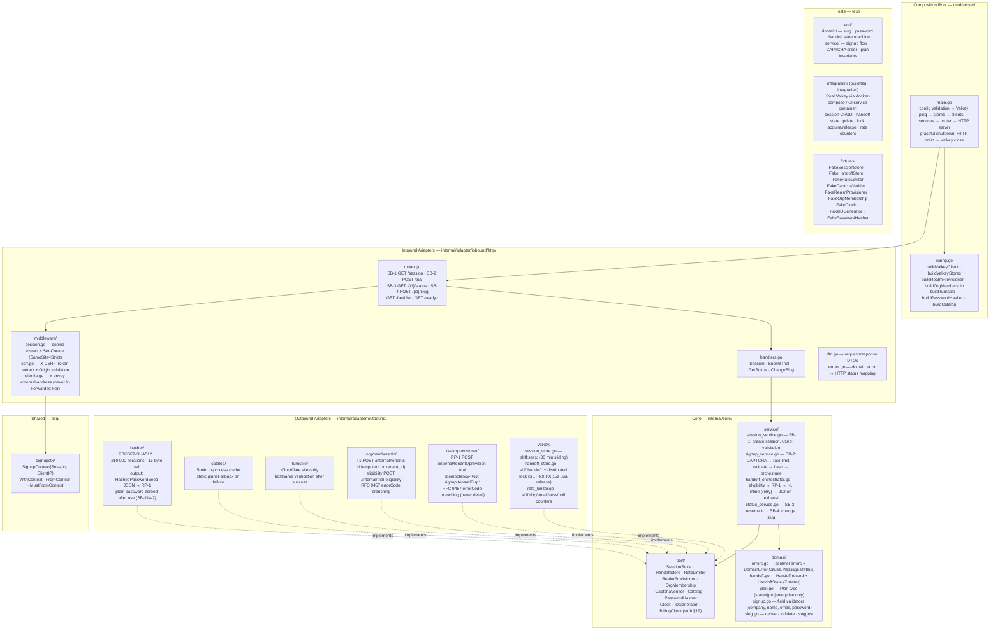
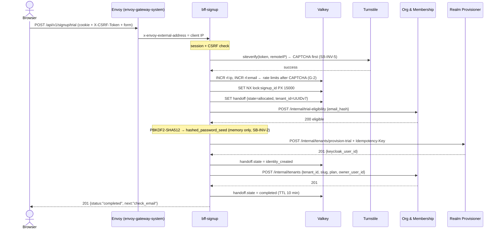
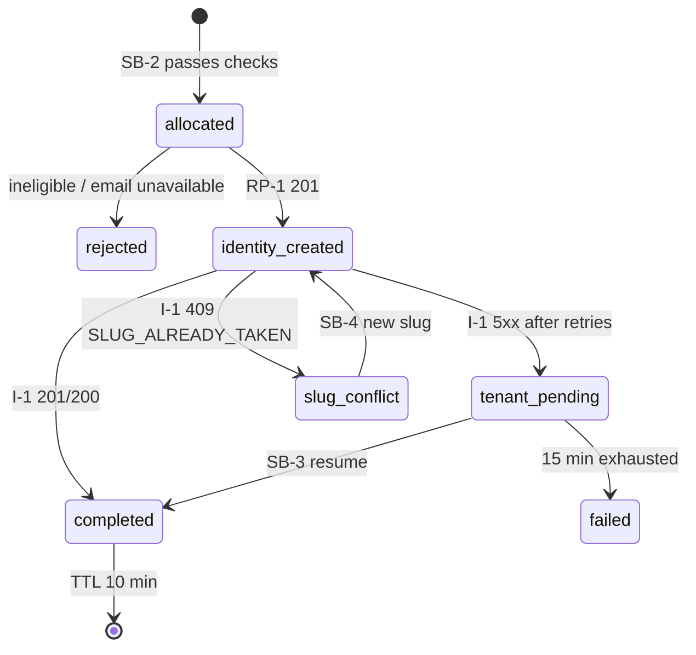

# Architecture

This document describes the internal structure, dependency rules, and runtime data flows of `bff-signup`.

`bff-signup` is the platform's **public, unauthenticated trial-signup intake** — the only internet-facing service that accepts requests without a JWT. It enforces abuse controls (CAPTCHA, rate limits, CSRF) and runs the provisioning handoff: eligibility check → RP-1 (Keycloak user) → I-1 (tenant row). It owns no business data and no database; state is ephemeral Valkey only.

---

## Layer model

Clean Architecture with hexagonal adapter layout. Inner layers have **zero knowledge** of outer layers; dependencies always point inward. Enforced by `go-arch-lint` (`.go-arch-lint.yml`).



---

## Dependency rules

```
domain   ← imports nothing internal
port     ← domain only
service  ← domain + port  (never adapters)
inbound  ← domain + port + service + signupctx
outbound ← domain + port
cmd      ← everything (only cmd wires adapters to ports)
```

No package imports a Keycloak client library (**SB-INV-6**). Enforced at CI by `go-arch-lint`.

---

## Request flows

### SB-2 happy path — POST /trial



### I-1 failure — 202 + resume via SB-3

When I-1 fails after RP-1 succeeds: inline retries (×2, 100ms/250ms) → `tenant_pending` → `202`. Browser polls SB-3; StatusService acquires lock and retries I-1 once per poll. After 15 min → `failed`. O&M backstop (`TenantIdentityProvisioned` consumer) recovers abandoned signups independently.

---

## Handoff state machine



---

## Security architecture

| Control | Mechanism | Layer |
|---|---|---|
| Bot prevention | Cloudflare Turnstile (invisible, every SB-2) | Outbound adapter |
| CSRF | Synchronizer token (SHA-256 in session, `X-CSRF-Token` header, constant-time compare) | Middleware |
| Origin check | `Origin` header must equal `signup.bcbpsolutions.com` on every POST | Middleware |
| Rate limiting | Per-IP: 3/hour; per-email: 5/24h; per-session: 20 sessions/IP/hour; polls: 60/min | Valkey counters |
| Client IP | `x-envoy-external-address` only — never `X-Forwarded-For` | Middleware |
| Password | PBKDF2-SHA512, 210,000 iterations, 16-byte salt; plain text never leaves memory | Hasher adapter |
| Email privacy | HMAC-SHA256(email, SBFF_HMAC_KEY) in Valkey — raw email never stored | Service layer |
| Mesh identity | SPIFFE `spiffe://<trust>/ns/bff/sa/bff-signup`; Istio mTLS to RP-1 and I-1 | Istio sidecar |
| Session isolation | SB-3/SB-4 reject `signup_id` not owned by caller's session | Service layer |

---

## Valkey key catalogue (LLD §4.1)

| Key | TTL | Purpose |
|---|---|---|
| `sbff:sess:<sid>` | 30 min sliding | Session: csrf_hash, signup_id |
| `sbff:handoff:<signup_id>` | 30 min (10 min after completed) | Provisioning state |
| `sbff:lock:<signup_id>` | 15 s | Distributed lock (SET NX PX) |
| `sbff:rl:ip:<ip>` | 1 h | Per-IP signup counter |
| `sbff:rl:email:<hmac>` | 24 h | Per-email attempt counter |
| `sbff:rl:sess:<ip>` | 1 h | Per-IP session counter |
| `sbff:rl:poll:<sid>` | 1 min | Per-session poll counter |

Valkey failure → `503 dependency_unavailable` (fail-closed). No snapshots or backups — losing Valkey loses only in-flight signups and counters; the O&M backstop recovers any `identity_created` signups.

---

## Deployment topology

- **Namespace:** `bff` | **ServiceAccount:** `bff-signup`
- **Replicas:** 2 min, 5 max | **HPA:** CPU 70% (PBKDF2 is CPU-bound)
- **Resources:** `250m/1 CPU`, `128Mi/256Mi` memory
- **Ingress:** only from `envoy-gateway-system` (API :8080) and `monitoring` (:9090)
- **Egress:** DNS, Valkey :6379, IAM services :8080, Turnstile :443, OTel :4317
- **Secrets:** External Secrets Operator → OpenBao (`secret/data/bff/bff-signup/*`)
