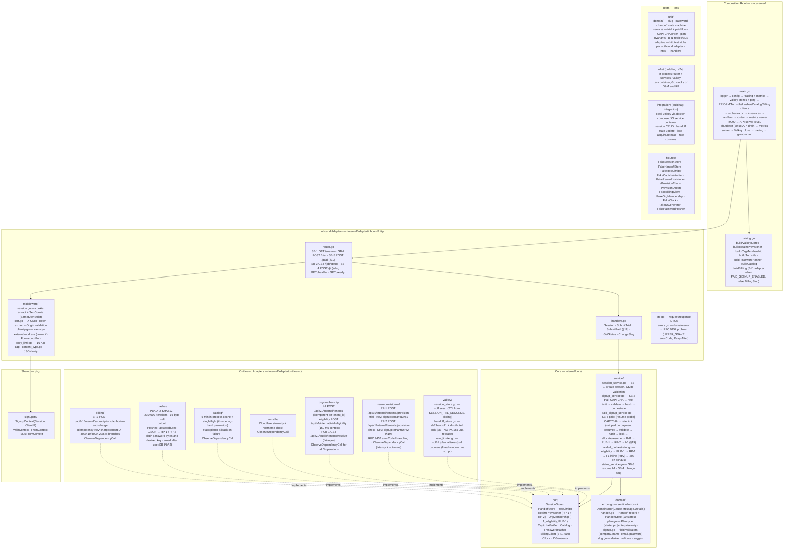

# Architecture

This document describes the internal structure, dependency rules, and runtime data flows of `bff-signup`.

`bff-signup` is the platform's **public, unauthenticated signup intake (trial and direct-paid)** — the only internet-facing service that accepts requests without a JWT. It enforces abuse controls (CAPTCHA, rate limits, CSRF) and runs the provisioning handoff. Trial: eligibility → PUB-1 → RP-1 (Keycloak user) → I-1 (tenant row). Paid: Billing B-I1 (charge) → PUB-1 → RP-2 (dedicated realm + user) → I-1. It owns no business data and no database; state is ephemeral Valkey only.

---

## Layer model

Clean Architecture with hexagonal adapter layout. Inner layers have **zero knowledge** of outer layers; dependencies always point inward. Enforced by `go-arch-lint` (`.go-arch-lint.yml`).



---

## Dependency rules

```
domain   ← imports nothing internal
port     ← domain only
service  ← domain + port + metrics (internal/adapter/outbound/metrics; never other adapters)
inbound  ← domain + port + service + signupctx + middleware + docs/swagger
outbound ← domain + port + metrics
cmd      ← everything (only cmd wires adapters to ports)
```

These rules are enforced at CI by `go-arch-lint` (`.go-arch-lint.yml`). No package imports a Keycloak client library (**SB-INV-6**): that is a review rule, because `.go-arch-lint.yml` sets `depOnAnyVendor: true` and does not check vendor imports.

---

## Request flows

### SB-2 happy path — POST /trial

```mermaid
sequenceDiagram
    actor B as Browser
    participant E as Envoy (envoy-gateway-system)
    participant S as bff-signup
    participant V as Valkey
    participant T as Turnstile
    participant OM as Org & Membership
    participant RP as Realm Provisioner

    B->>E: POST /api/v1/signup/trial (cookie + X-CSRF-Token + form)
    E->>S: x-envoy-external-address = client IP
    Note over S: session + CSRF check
    S->>T: siteverify(token, remoteIP) ← CAPTCHA first (SB-INV-5)
    T-->>S: success
    S->>V: INCR rl:ip, INCR rl:email  ← rate limits after CAPTCHA (G-2)
    Note over S: validate · PBKDF2-SHA512 → hashed_password_seed (memory only, SB-INV-2)
    S->>V: SET NX lock:signup_id PX <lock TTL>
    S->>V: SET handoff {state=allocated, tenant_id=UUIDv7}
    S->>OM: POST /api/v1/internal/trial-eligibility {email_hash}
    OM-->>S: 200 eligible
    S->>OM: GET /api/v1/public/tenants/resolve (PUB-1, fail-open; taken → 409, handoff stays allocated)
    OM-->>S: {found:false}
    S->>RP: POST /api/v1/internal/tenants/provision-trial + Idempotency-Key
    RP-->>S: 201 {keycloak_user_id}
    S->>V: handoff.state = identity_created
    S->>OM: POST /api/v1/internal/tenants {tenant_id, slug, plan, owner_user_id}
    OM-->>S: 201
    S->>V: handoff.state = completed (TTL 10 min)
    S-->>B: 201 {status:"completed", next:"check_email"}
```

### I-1 failure — 202 + resume via SB-3

When I-1 fails after RP-1 succeeds: inline retries (×2, 100ms/250ms) → `tenant_pending` → `202`. Browser polls SB-3; StatusService acquires lock and retries I-1 once per poll. After 15 min → `failed`. O&M backstop (`TenantIdentityProvisioned` consumer) recovers abandoned signups independently.

### SB-5 — POST /paid (LLD §19)

Same front half as SB-2 (CAPTCHA → rate limit → validate → hash → lock), then Billing B-I1 `charge:<tenant_id>` → PUB-1 → RP-2 (`signup:<tenant_id>:rp2`) → I-1. On `402 PAYMENT_ACTION_REQUIRED` the BFF returns `202 payment_action_required` with the 3-D Secure `client_secret`; the browser authenticates and re-POSTs the same body, and the BFF resumes the same `tenant_id`, so Billing sees the same key and body. The handoff and the session are held until Billing's `expires_at + 15 min`, so a late re-POST (Billing then answers `201` if the customer paid) still resumes this attempt. Unknown Billing outcomes keep the handoff (`503` + `Retry-After`); declines (`422`) and expiry (`410`) delete it. Past payment, a resubmit never allocates a new `tenant_id`.

---

## Handoff state machine

Same diagram as LLD §9.1 and `docs/architecture/mermaid/handoff-state-machine.mmd` — keep all three identical.

```mermaid
stateDiagram-v2
    [*] --> allocated : SB-2 passes CAPTCHA, rate limit, validation · tenant_id allocated
    [*] --> payment_pending : SB-5 passes CAPTCHA, rate limit, validation · tenant_id allocated

    %% Trial path (SB-2)
    allocated --> allocated : eligibility / RP-1 5xx or timeout after one retry (503); PUB-1 slug taken (409, no Keycloak user; resubmit with a new slug)
    allocated --> identity_created : RP-1 201
    allocated --> [*] : eligibility 409 TRIAL_ALREADY_USED / RP-1 409 EMAIL_ALREADY_REGISTERED / resubmit with other details (handoff deleted)

    %% Paid path (SB-5, §19)
    payment_pending --> payment_pending : B-I1 timeout / 500-504 / REQUEST_IN_PROGRESS (503 + Retry-After), 409 SUBSCRIPTION_ALREADY_EXISTS or an unexpected reply (500)
    payment_pending --> payment_action_required : B-I1 402 PAYMENT_ACTION_REQUIRED (202 to browser)
    payment_pending --> payment_confirmed : B-I1 201 / 200 replay
    payment_action_required --> payment_action_required : re-POST; still pending, timeout or 5xx
    payment_action_required --> payment_confirmed : re-POST after 3-D Secure; B-I1 201
    payment_pending --> [*] : B-I1 402 PAYMENT_DECLINED / 410 CHARGE_EXPIRED / 422 PRICE_NOT_AVAILABLE (handoff deleted)
    payment_action_required --> [*] : B-I1 402 PAYMENT_DECLINED / 410 CHARGE_EXPIRED (handoff deleted)
    payment_confirmed --> payment_confirmed : PUB-1 / RP-2 slug taken (409) or RP-2 error; resubmit skips Billing (details frozen once RP-2 was called)
    payment_confirmed --> identity_created : RP-2 201

    %% Shared I-1 path
    identity_created --> completed : I-1 201/200
    identity_created --> tenant_pending : I-1 5xx/timeout after 2 inline retries
    identity_created --> slug_conflict : I-1 409 SLUG_ALREADY_TAKEN
    tenant_pending --> completed : SB-3 resume succeeds
    tenant_pending --> failed : 15 min exhausted
    slug_conflict --> identity_created : SB-4 new slug (max 5 attempts)

    completed --> [*] : TTL 10 min
    failed --> [*] : TTL 30 min
```

---

## Security architecture

| Control | Mechanism | Layer |
|---|---|---|
| Bot prevention | Cloudflare Turnstile (invisible, every SB-2 and SB-5); CAPTCHA must pass before any rate-limit increment (SB-INV-5) | Outbound adapter |
| CSRF | Synchronizer token (SHA-256 in session, `X-CSRF-Token` header, `subtle.ConstantTimeCompare`) | Middleware |
| Origin check | `Origin` header must equal `signup.bcbpsolutions.com` on every POST | Middleware |
| Clickjacking | `X-Frame-Options: DENY` on every response | Middleware |
| Referrer leak | `Referrer-Policy: strict-origin-when-cross-origin` on every response | Middleware |
| Slowloris | `ReadHeaderTimeout: 5s` on the HTTP server | `main.go` |
| Rate limiting | Fixed-window Lua script (not sliding); per-IP: 3/hour; per-email: 5/24h; session starts per IP: 20/hour; polls: 60/min (all from `RATE_*`) | Valkey counters |
| Body size | `MaxBytesReader` + Content-Length fast-path; 16 KB hard cap | Middleware |
| CAPTCHA_SKIP guard | `config.Validate()` rejects `CAPTCHA_SKIP=true` when `APP_ENV` ≠ dev/test/local | Config |
| Client IP | `x-envoy-external-address` only — never `X-Forwarded-For`; gin trusted proxies disabled (`SetTrustedProxies(nil)`), so forged forwarded headers are ignored | Middleware / engine |
| Password | PBKDF2-SHA512, 210,000 iterations, 16-byte salt; plain text never leaves process memory; derived key zeroed after encoding | Hasher adapter |
| Email privacy | HMAC-SHA256(email, SBFF_HMAC_KEY) in Valkey — raw email never stored or logged; comparison uses `subtle.ConstantTimeCompare` | Service layer |
| Handoff race guard | Distributed lock acquired before deleting StateAllocated handoff on resubmit-with-different-details | Service layer |
| Mesh identity | SPIFFE `spiffe://<trust>/ns/bff/sa/bff-signup`; Istio mTLS to Realm Provisioner, Org & Membership and Billing | Istio sidecar |
| Payment data | Only the provider's browser token (`pm_…`) is accepted; only its HMAC is stored; Billing's `client_secret` goes to the browser and is never logged or stored | Service layer |
| Session isolation | SB-3/SB-4 reject `signup_id` not owned by caller's session | Service layer |

---

## Valkey key catalogue (LLD §4.1)

| Key | TTL | Purpose |
|---|---|---|
| `sbff:sess:<sid>` | 30 min sliding | Session: csrf_hash, signup_id |
| `sbff:handoff:<signup_id>` | 30 min (10 min after completed) | Provisioning state (trial and paid) |
| `sbff:lock:<signup_id>` | 15 s | Distributed lock (SET NX PX) |
| `sbff:rl:ip:<ip>` | 1 h | Per-IP signup counter |
| `sbff:rl:email:<hmac>` | 24 h | Per-email attempt counter |
| `sbff:rl:sess:<ip>` | 1 h | Per-IP session counter |
| `sbff:rl:poll:<sid>` | 1 min | Per-session poll counter |

Valkey failure → `503 DEPENDENCY_UNAVAILABLE` (fail-closed). No snapshots or backups — losing Valkey loses only in-flight signups and counters; the O&M backstop recovers any `identity_created` signups.

---

## Deployment topology

- **Namespace:** `bff` | **ServiceAccount:** `bff-signup`
- **Replicas:** 2 min, 5 max | **HPA:** CPU 70% (PBKDF2 is CPU-bound)
- **Resources:** `250m/1 CPU`, `128Mi/256Mi` memory
- **Ingress:** only from `envoy-gateway-system` (API :8080) and `monitoring` (:9090)
- **Egress:** DNS, Valkey :6379, IAM services and Billing :8080, Turnstile :443, OTel :4317
- **Secrets:** External Secrets Operator → OpenBao (`secret/data/bff/bff-signup/*`)
