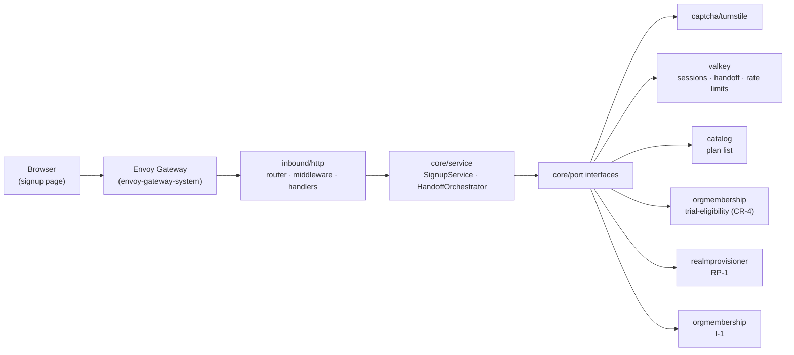
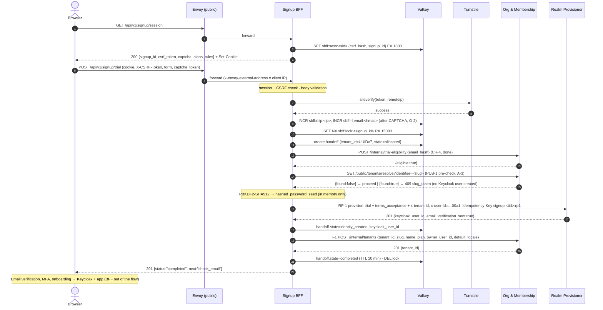
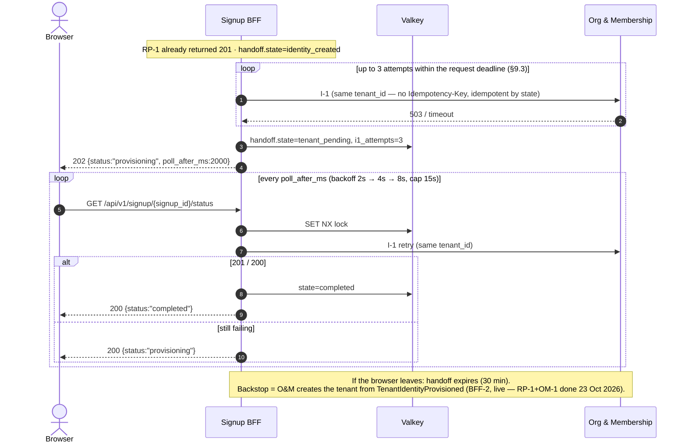
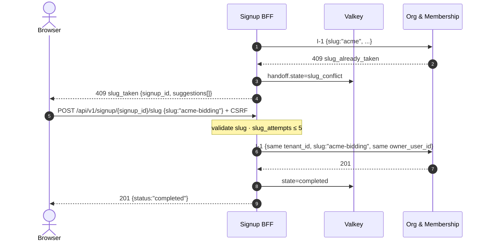

# Signup BFF Service — Low-Level Design

## Tender Management SaaS Platform — Edge / BFF Tier

| Field | Value |
|---|---|
| Document type | Low-Level Design (LLD) |
| Service | `bff-signup` (Signup Service / "Signup BFF") |
| Repository / Go module | `BCBP-SOLUTIONS-FZC-LLC/bff-signup` → `github.com/BCBP-SOLUTIONS-FZC-LLC/bff-signup` (BFF-6, decided) |
| Status | **Production-ready (Phase 1).** All go-live blockers cleared. Code, tests, CI, and deployment configuration fully hardened. **Deferred to future phases:** on-call/PagerDuty setup (BFF-6, pending procurement), Keycloak existing-realm policy sweep (N-10a, pending Keycloak phase), direct-paid signup / Phase 1.5 (pending Billing service), all SRE infra provisioning (BFF-1/2/4, pending infra phase). |
| Version | 1.0 |
| Date | 2026-10-28 |
| Base HLD | `bff-hld-tender-saas-v1.0.md` (Edge / BFF Tier HLD v1.0) + *Signup BFF — TL Responses: HLD Gaps (BFF-1 to BFF-6)*, 21 Oct 2026 |
| Scope | **Phase 1 — trial signup only** (BFF HLD §7.1, §15). Direct-paid signup (Phase 1.5) is reserved, not specified (§19) |
| Sibling LLDs | `iam-lld-realm-provisioner-service.md` **rev 1.37** (RP-1 callee; payload expanded), `iam-lld-org-membership-service.md` **rev 2.33** (I-1 + PUB-1 callee; backstop live) |
| Owner database | **None.** Ephemeral Valkey only (§4) |
| Namespace | `bff` (never `iam`) — service account `bff-signup` (BFF-1, decided) |
| Owning team | Web / growth |
| Deployment stage | Not started — nothing deployed to any environment |
| Audience | Web / growth engineering (owner), IAM platform engineering (RP-1 / I-1 owners), IAM platform security (mesh trust), SRE |

### Revision history

| Version | Date | Changes |
|---|---|---|
| 1.1 | 2026-10-31 | **Spec and behaviour aligned after E2E testing.** Code now follows the spec: `Retry-After` header on every `429`; eligibility and RP-1 retried once on `5xx`/timeout, RP-1 also once on `409 operation_in_progress` (§9.3, §17.2). Spec text corrected to match intended behaviour: allocated resubmit with different details keeps the session's `signup_id` and issues a new `tenant_id` (§5.4); a slug conflict is not a provisioning-failure metric (§9.5); an expired session cookie gives `401` before `404` (§5.5). |
| 1.0 | 2026-10-28 | **Production hardening pass — Phase 1 code complete.** Security: CSRF and email HMAC now use `subtle.ConstantTimeCompare`; `X-Frame-Options: DENY` and `Referrer-Policy: strict-origin-when-cross-origin` added to all responses; `ReadHeaderTimeout: 5s` added (Slowloris); `CAPTCHA_SKIP=true` rejected outside dev/test/local by `config.Validate()`; rate limiter converted from sliding-window to fixed-window Lua script; handleResubmit acquires distributed lock before deleting StateAllocated handoff (race safety). Correctness: SB-4 now returns 409 with suggestions (was returning 202); `SuggestSlugs` capped at 50 iterations; session TTL and all four rate-limit thresholds are now configurable from env vars (were hardcoded constants); eligibility timeout wired from `ELIGIBILITY_TIMEOUT_MS`; config bounds validation added for all timeouts and `SESSION_TTL_SECONDS`; Valkey errors in SB-3/SB-4 now return 503 (were 404). Observability: `bff_signup_dependency_call_duration_seconds` was registered but never called — all four outbound adapters (orgmembership, realmprovisioner, turnstile, catalog) now call `ObserveDependencyCall` after `httpClient.Do()`; startup now emits structured `log.Info` at each init phase; all logs/metrics/traces pass through platform-gincommon (enforced by new CI lint). Deployment: `terminationGracePeriodSeconds: 35` and `topologySpreadConstraints` added; `values-prod.yaml` now self-contained; duplicate YAML keys removed. CI: `check-log-sink.sh` and `log-sink-lint` Makefile target added; `check-metric-naming.sh` enhanced with adapter-instrumentation enforcement and label-vocabulary checks; coverage gate corrected to 95%. 20+ tests added. Go 1.26.10. `prometheus/common` v0.73.0. |
| 0.9 | 2026-10-26 | **Deferred items marked.** Four items formally deferred to future phases after cross-service gap review (BFF + O&M + RP): (1) BFF-6 on-call / PagerDuty — deferred until PagerDuty procured; (2) N-10a Keycloak existing-realm policy sweep — deferred to Keycloak phase; (3) Phase 1.5 direct-paid signup — deferred until Billing service is built; (4) SRE infra gaps (BFF-1/2/4) — deferred to infra phase. §16.1 and §16.2 updated with DEFERRED labels and reasons. §19 updated with deferred activation note. BFF code fixes applied: `x-tenant-roles: iam-system` header added to I-1 and eligibility calls; `licensed_seats` field added to `ProvisionTenantRequest`, `Handoff`, and `callI1Once`; paid signup handoff wires `LicensedSeats` from `in.Seats`. |
| 0.8 | 2026-10-23 | **All go-live blockers cleared; backstop fully functional.** RP-1: `TrialTenantProvisionedPayload` expanded — `KeycloakUserID` renamed to `OwnerUserID`, `Slug`/`Name`/`Plan` added (`event.go:69–75`, `provisioning_service.go:403`); schema and AsyncAPI spec updated. RP-4: `validPlan()` wired into RP-1 handler (one line). O&M rev 2.33: `TrialTenantProvisioned` handler activated as backstop with three idempotency layers (processOnce dedup, tenantExists check, ON CONFLICT); `iam_org_membership_tenant_provisioning_backstop_total` metric live; `IAMSignupProvisioningRejected` alert added; docs corrected (BFF produces zero events). BFF: terms version validation tightened — `TermsVersion` now checked against `CurrentTermsVersion`; SB-1 response now includes `current_terms_version` so browser knows which version to echo back. §7 event table updated (payload now live). §9.4 backstop status updated from "pending" to "live". §18.1 and §18.2 stale "open" notes cleared. Sibling LLD versions: RP rev 1.37, O&M rev 2.33. |
| 0.7 | 2026-10-23 | **IAM reply (A-1…A-4) applied; BFF code gaps closed.** Sibling LLD versions updated: RP rev 1.31 → 1.37, O&M rev 2.30 → 2.38. A-1: pod-level SPIFFE admission corrected on both O&M and RP (PR #33/#27); §10.1 table updated. A-2: `gateway` removed from RP `existingCallerNamespaces` (PR #28). A-3 (BFF-2a): PUB-1 server-side slug pre-check implemented (`CheckSlugFree` in `orgmembership/client.go`, called in `handoff_orchestrator.go` before RP-1); §5.6 step table and §8.1 sequence diagram updated; §9.4 "Remaining open" note removed. A-4 (N-5): `terms_acceptance` added to `port.ProvisionTrialRequest` and sent on every RP-1 call (`version`, `accepted_at`, `ip_address`, `user_agent` ≤512 bytes); §5.6 RP-1 request body updated; §18.1 updated. N-7: `handoffs.Get` error in `signup_service.go` no longer silently ignored. N-11 (timeout budget): `runOp` 50 ms Valkey op deadline + 1 retry; 2,500 ms SB-2 `context.WithTimeout` in `SubmitTrial` handler. N-8/N-9 confirmed already implemented. N-2/N-4 closed. §16 restructured: open = SRE prod tasks + BFF-6 + N-3/N-10; resolved = all else. |
| 0.6 | 2026-10-22 | **Pre-coding final pass.** Sibling LLD versions updated: RP rev 1.29 → 1.31, O&M rev 2.28 → 2.30. §5.6 eligibility response corrected — not-eligible is `409 errorCode: TRIAL_ALREADY_USED` (RFC 9457), not `{eligible:false}`. §17 intro updated: O&M now also returns RFC 9457 (rev 2.29+). §17.2 upstream error codes updated to `UPPER_SNAKE_CASE` RFC 9457 format for both RP and O&M. §8.1 G-3 note updated — N-12 resolved (I-8 → 404 → AuthZ → 403). N-12 closed in §16.2. §20.2 references updated. Pending TL decisions (A-1 to A-4) tracked in `signup-bff-open-questions-tl.md`. |
| 0.5 | 2026-10-22 | **IAM implementation verified; stale references cleared.** CR-1 (email_already_registered), CR-2 (hashed_password_seed + realm hash policy), CR-3 (RP bffCaller AuthorizationPolicy + NetworkPolicy; O&M bff added to existingCallerNamespaces), CR-4 (trial_signup_ledger + POST /internal/trial-eligibility), F-2 (BFF removed from RP-3/RP-11 docs) — all confirmed done in code. §5.6 eligibility and RP-1 status updated from "proposed" to "done". §8.4 "(C-3, proposed)" corrected. §10.1 current-state table replaced with resolved state. F-1 and F-2 moved from §16.2 open to resolved. §16.3 CRs marked done. §18.1 and §18.2 updated. New open item TL-1 added (§16.2): O&M used namespace-level admission (`bff` in existingCallerNamespaces) vs the LLD's pod-level requirement — TL decision needed. |
| 0.4 | 2026-10-22 | **All TL decisions confirmed and cross-checked against TL responses (21 Oct 2026).** Status updated from "Draft for TL review" to "Ready for sign-off". BFF-6 repo decision added to the status line (was applied in v0.3 but omitted from the summary). §16.2 open-items register verified accurate — all remaining items are IAM/SRE action items, not unresolved design decisions. No substantive content changes; all gap resolutions were correctly applied in v0.3. |
| 0.3 | 2026-10-21 | **TL decisions applied.** Namespace `bff`, service account and repo `bff-signup` (BFF-1, BFF-6). Backstop switched to O&M's `TenantIdentityProvisioned` consumer, now built (RP #19/#20, O&M #25, Audit Log #5); `TrialTenantProvisioned` retired (BFF-2). Turnstile, `signup.bcbpsolutions.com`, Billing deferred confirmed (BFF-3…5). RP-1 `plan` validation adopted: BFF sends only `starter`/`pro`/`enterprise` and identical `plan`/`slug`/`name` to RP-1 and I-1 (new SB-INV-8, §18.4). RP-1 errors now RFC 9457 (`status` + `errorCode`). Review fixes G-1…G-10: details-changed resubmit, rate limit counted after CAPTCHA, early-verification UX, BFF password check authoritative, Envoy namespace `envoy-gateway-system`, Turnstile `ServiceEntry`, ElastiCache Valkey, current error envelope, CPU-only HPA, sign-off table (§21). |
| 0.2 | 2026-10-16 | **C-1…C-7 resolved.** C-1, C-2, C-5, C-6 resolved from the reference LLDs (RP v1.29, O&M rev 2.28); C-3, C-4, C-7 resolved to the recommended option as change requests to IAM (§16.1). I-1 no longer sends an `Idempotency-Key` (O&M is idempotent by state, O&M §9.2). BFF password check made authoritative under C-4. Slug rule confirmed as a subset of O&M's DNS-label rule. |
| 0.1 | 2026-10-16 | Initial draft. Built on the HLD, the RP-1 contract (RP LLD §5.3–§5.4, §8.0–§8.1, §9.2, §17, §18.1) and the I-1 contract (O&M LLD §5.3, I-1 spec, §8.1). Open items BFF-1…6, C-1…7, N-1…11 recorded in §16 with working assumptions. Checked against RP LLD v1.29 and O&M LLD rev 2.28: mesh is Istio (trust domain `cluster.local`); RP already admits the `gateway` namespace (RP v1.27) but O&M does not (new finding F-1, §10.1); RP lists the BFF as a caller of RP-3/RP-11 (F-2). |

---

## Table of Contents

1. Document Overview
2. Service Responsibilities and Boundaries
3. Architecture and Package Layout
4. Data Model (Ephemeral State)
5. API Contract
6. Caching Design
7. Event Architecture
8. Key Request Flows
9. Concurrency, Consistency, and Failure Handling
10. Security
11. Observability
12. Configuration
13. Deployment and Scaling
14. Testing Strategy
15. Data Lifecycle, Privacy, and DR
16. Open Questions Register
17. Appendix — Error Taxonomy
18. Integration Details
19. Phase 1.5 Reservation — Direct-Paid Signup
20. Appendix — Glossary and References
21. Review and Sign-off

---

## 1. Document Overview

The Signup BFF is the platform's **public, unauthenticated tenant-onboarding intake**. It serves the signup form's API, enforces abuse controls (rate limit, CAPTCHA), and runs the **provisioning handoff**: it calls Realm Provisioner **RP-1** to create the owner in Keycloak, then Org & Membership **I-1** to create the tenant. It owns no business data, makes no Keycloak Admin API call, issues no token, and produces or consumes no bus event (BFF HLD §3.2, §9).

This LLD turns the HLD into a buildable specification: endpoints, payloads, Valkey keys, the handoff state machine, retry and timeout rules, security controls, metrics, configuration, and tests.

### 1.1 Relationship to the HLD

| HLD section | Where it is specified here |
|---|---|
| §4 Architecture | §3 package layout, §13 Kubernetes resources |
| §6 Statelessness | §4 Valkey key catalogue |
| §7.1 Trial signup | §5 SB-1…SB-4, §8.1 |
| §7.3 Two-call consistency | §8.2–§8.3, §9 handoff state machine |
| §8 Integration contracts | §5.6 outbound contracts, §18 |
| §10 Security | §10 |
| §11 Observability | §11 |
| §16 Open decisions | §16 (with C-1…7 and N-1…11 added) |

### 1.2 Corrections to the HLD carried in this LLD

These follow the IAM LLDs, which are code-verified, and are proposed for HLD v1.1:

| HLD statement | This LLD | Gap |
|---|---|---|
| §7.1 step 7: I-1 body `{id, plan:"trial", trial_ends_at, …}` | `{tenant_id, slug, name, plan: starter\|pro\|enterprise, owner_user_id, default_locale}`; O&M computes `trial_ends_at` | C-1 |
| §7.1 step 3: CAPTCHA only on duplicate email | CAPTCHA on **every** submission (duplicates are only known after RP-1) | BFF-3 |
| §6: "password-reset-style probing counters" | Duplicate-email / per-email attempt counter; password reset is Keycloak's | — |
| §4.2: two calls into `iam` | Three — eligibility check before RP-1 is now built (CR-4) | C-7 → CR-4 |

---

## 2. Service Responsibilities and Boundaries

### 2.1 In scope

- Public JSON API for the trial signup form (SB-1…SB-4, §5).
- Server-side validation of company, admin, slug, plan and password-policy inputs.
- Abuse controls: per-IP and per-email rate limits, CAPTCHA verification, CSRF protection.
- Allocation of the caller-supplied `tenant_id` (UUIDv7) and the tenant slug.
- Hashing the password into the `hashed_password_seed` format RP-1 accepts (C-4).
- The provisioning handoff: eligibility check → RP-1 → I-1, with retry, resume and slug-conflict handling.
- Funnel metrics, traces and redacted logs.

### 2.2 Out of scope (owned elsewhere)

| Concern | Owner |
|---|---|
| Login, logout, tokens, sessions, MFA | Keycloak / Envoy |
| Email verification, **forgot password**, invitation acceptance | Keycloak (built-in flows) |
| Keycloak Admin API | Realm Provisioner only (RP-INV-1) |
| `tenants`, memberships, roles, trial end date | Org & Membership |
| One-trial-per-email ledger | Org & Membership (`trial_signup_ledger`) |
| Payment, subscriptions | Billing (Phase 1.5) |
| Signup page UI | Web frontend app (assumed — N-6) |

### 2.3 Core invariants

| # | Invariant |
|---|---|
| SB-INV-1 | **No durable business data.** Nothing about a tenant, user or payment is written to a store the BFF owns beyond the TTL-bounded Valkey keys in §4. |
| SB-INV-2 | **The plain password never leaves process memory.** It is not logged, not stored in Valkey, not sent to any service; only `hashed_password_seed` is sent to RP-1. |
| SB-INV-3 | **One `tenant_id` per signup attempt.** A `tenant_id` is allocated once per `signup_id` and reused for every retry, resume and slug change, so RP-1 and I-1 always agree and never duplicate. |
| SB-INV-4 | **RP-1 before I-1, always.** `owner_user_id` sent to I-1 is the `keycloak_user_id` RP-1 returned — never invented by the BFF (C-6). |
| SB-INV-5 | **CAPTCHA and rate limit run before any internal call or password hashing**, so a bot cannot reach IAM or burn CPU. |
| SB-INV-6 | **No Keycloak and no admin-plane access.** The BFF's mesh identity is allow-listed only for the internal routes in §5.6 (BFF-1). |
| SB-INV-7 | **Client-side checks are UX only**, with one exception: the password policy. Because the credential reaches Keycloak pre-hashed (C-4), the BFF's password check is the only one at signup (§10.6). For everything else RP-1 and I-1 remain authoritative; their rejection is final. |
| SB-INV-8 | **RP-1 and I-1 carry identical `plan`, slug and name.** O&M keeps the values from whichever creates the tenant first — the BFF's I-1 or the backstop driven by RP's `TenantIdentityProvisioned` (live, expanded payload) — and ignores later differing values. `plan` is always `starter`, `pro` or `enterprise`, never `trial` (RP-1 rejects anything else). The only permitted difference is a slug changed through SB-4 after `409 slug_taken`, which is safe because RP's event with the original slug is permanently rejected by O&M (§9.4). |

---

## 3. Architecture and Package Layout

Hexagonal layout, matching the IAM services (ports in `core/port`, adapters in `adapter/`).



```
bff-signup/
├── cmd/server/main.go                 # wiring, graceful shutdown
│             wiring.go               # client factories incl. buildBilling() stub
├── internal/
│   ├── config/                        # env + file config, validation, fail-fast
│   │                                  # PAID_SIGNUP_ENABLED, BILLING_BASE_URL added (§19)
│   ├── core/
│   │   ├── domain/                    # pure types, no I/O
│   │   │   ├── signup.go              # SignupRequest, validation rules
│   │   │   ├── slug.go                # derive, normalize, validate, suggest (N-1)
│   │   │   ├── handoff.go             # Handoff record + state machine (§9.1)
│   │   │   │                          # Phase 1.5: payment_pending, payment_confirmed,
│   │   │   │                          # SignupType (trial|paid), BillingSubscriptionID
│   │   │   ├── plan.go
│   │   │   └── errors.go              # domain error codes (§17)
│   │   ├── port/
│   │   │   ├── realm_provisioner.go   # ProvisionTrial (RP-1) + ProvisionDirect (RP-2, §19)
│   │   │   ├── org_membership.go      # ProvisionTenant (I-1) + CheckEligibility (CR-4)
│   │   │   ├── captcha.go             # CaptchaVerifier.Verify(ctx, token, ip)
│   │   │   ├── catalog.go             # Plans(ctx)
│   │   │   ├── handoff_store.go       # Get/Create/Update/Lock (Valkey)
│   │   │   ├── session_store.go
│   │   │   ├── rate_limiter.go
│   │   │   ├── password_hasher.go     # Hash(password) → seed (C-4)
│   │   │   ├── billing.go             # BillingClient port + BillingStub (§19)
│   │   │   └── clock.go, idgen.go
│   │   └── service/
│   │       ├── session_service.go     # SB-1
│   │       ├── signup_service.go      # SB-2 trial entry, validation, abuse checks
│   │       ├── paid_signup_service.go # SB-5 direct paid signup (Phase 1.5, §19)
│   │       ├── handoff_orchestrator.go# eligibility → RP-1 → I-1, resume, slug change
│   │       └── status_service.go      # SB-3, SB-4
│   └── adapter/
│       ├── inbound/http/
│       │   ├── router.go              # SB-5 POST /paid wired when PAID_SIGNUP_ENABLED=true
│       │   ├── handlers.go            # Session · SubmitTrial · SubmitPaid · GetStatus · ChangeSlug
│       │   ├── dto.go                 # PaidSignupRequest / PaidSignupResponse added
│       │   └── middleware/            # session, csrf, clientip, bodylimit, nostore
│       └── outbound/
│           ├── realmprovisioner/      # RP-1 + RP-2 (ProvisionDirect, §19)
│           ├── orgmembership/         # I-1 + eligibility
│           ├── catalog/
│           ├── turnstile/
│           ├── valkey/
│           └── hasher/                # PBKDF2-SHA512
├── deploy/helm/
├── test/{integration,contract,e2e,load}/
└── .github/workflows/
```

### 3.1 Shared library dependencies

| Library | Used for | Notes |
|---|---|---|
| `platform-gincommon` | PanicRecovery, RequestID, Tracing, Metrics, Logging, `ErrorResponse` | **Not** `RequireAuth` / `ContextMiddleware` on public routes — no identity exists at signup. Use a `PublicMiddlewares` set (or compose the stack minus auth). |
| `platform-models` | Shared error/response types | — |
| `platform-events` | Not used (no bus participation) | — |
| `platform-pgcommon` | Not used (no database) | — |

### 3.2 Dependency rules (CI-enforced, `go-arch-lint`)

- `core/domain` imports nothing internal.
- `core/service` imports `domain` and `port` only.
- `adapter/*` imports `port` and `domain`; adapters never import each other.
- Only `cmd/server` wires adapters to ports.
- No package imports a Keycloak client library (enforces SB-INV-6).

---

## 4. Data Model (Ephemeral State)

There is **no database**. A dedicated **Amazon ElastiCache for Valkey** node (`cache.t3.micro`, HLD §13), not shared with the IAM cache, holds only the keys below. TLS and AUTH on, **no snapshots / backups**: losing it loses only in-flight signups and counters (§15).

### 4.1 Key catalogue

| Key | Type | Value | TTL | Written by |
|---|---|---|---|---|
| `sbff:sess:<sid>` | hash | `csrf_hash`, `signup_id`, `created_at` | 30 min (sliding) | SB-1 |
| `sbff:handoff:<signup_id>` | string (JSON) | Handoff record (§4.2) | 30 min, refreshed on each state change; 10 min after `completed` | SB-2, SB-3, SB-4 |
| `sbff:lock:<signup_id>` | string | owner token | 15 s (`SET NX PX`) | SB-2, SB-3, SB-4 |
| `sbff:rl:ip:<ip>` | counter | new signup attempts from this IP | 1 h | SB-2 |
| `sbff:rl:email:<hmac(email)>` | counter | attempts for this email | 24 h | SB-2 |
| `sbff:rl:sess:<ip>` | counter | sessions started | 1 h | SB-1 |
| `sbff:rl:poll:<sid>` | counter | status polls | 1 min | SB-3 |

`<sid>` is a 256-bit random session id. Email keys use **HMAC-SHA256** with a server secret (`SBFF_HMAC_KEY`, from OpenBao), so Valkey never holds a readable email.

### 4.2 Handoff record

```jsonc
{
  "signup_id":        "01JABCD...",          // ULID, bound to the session
  "tenant_id":        "0192f0c4-...-7...",   // UUIDv7, allocated once (SB-INV-3)
  "state":            "identity_created",    // §9.1
  "slug":             "acme",
  "company_name":     "Acme Bidding Co",
  "plan":             "pro",
  "default_locale":   "en-US",
  "admin_email_hmac": "b64...",              // never the email itself
  "keycloak_user_id": "5717...",             // set after RP-1
  "slug_attempts":    1,
  "i1_attempts":      2,
  "last_error":       "org_membership_unavailable",
  "created_at":       "2026-10-16T09:00:00Z",
  "updated_at":       "2026-10-16T09:00:02Z"
}
```

**Not stored:** password, `hashed_password_seed`, admin email, admin name, CAPTCHA token. Only what I-1 or SB-3/SB-4 needs is kept. Company name and slug are organisational data, held at most 30 minutes.

---

## 5. API Contract

### 5.1 Conventions

- Public routes under `/api/v1/signup`, served on `https://signup.bcbpsolutions.com`, same origin as the page (BFF-4, decided). Breaking changes ship under `/api/v2`.
- `application/json`, UTF-8, request body limit **16 KB**. Timestamps RFC 3339 UTC.
- Every response: `Cache-Control: no-store`, `X-Content-Type-Options: nosniff`, `X-Request-Id`.
- Errors use the `gincommon.ErrorResponse` shape: `{ error, status, trace_id, request_id, details? }` (§17).
- State-changing routes (`POST`) require the session cookie **and** `X-CSRF-Token` (§10.4).
- No JWT, no `x-user-id` / `x-tenant-id` accepted from the browser; any such inbound header is stripped by Envoy and ignored by the BFF.

### 5.2 Endpoint catalogue — public (inbound)

| # | Method + Path | Purpose | CSRF |
|---|---|---|---|
| SB-1 | `GET /api/v1/signup/session` | Start a signup session: sets cookie, returns CSRF token, CAPTCHA site key, plans, password and slug rules | — |
| SB-2 | `POST /api/v1/signup/trial` | Submit the trial form; runs abuse checks and the handoff. `201` done / `202` still finishing / `409` slug conflict | Yes |
| SB-3 | `GET /api/v1/signup/{signup_id}/status` | Poll after `202`; resumes an unfinished I-1 | — (session-bound) |
| SB-4 | `POST /api/v1/signup/{signup_id}/slug` | Pick a new slug after `409 slug_taken`; retries I-1 with the same `tenant_id` | Yes |
| SB-5 | `POST /api/v1/signup/paid` | Direct paid signup (Phase 1.5, §19): Billing charge → RP-2 → I-1. Returns `404` until `PAID_SIGNUP_ENABLED=true`. Same session + CSRF guards as SB-2 | Yes |
| SB-H | `GET /healthz`, `GET /readyz` | Liveness; readiness (Valkey + config) | — |
| SB-M | `GET /metrics` | Prometheus, separate port, monitoring namespace only | — |

### 5.3 SB-1 `GET /api/v1/signup/session`

Creates `sbff:sess:<sid>` and a fresh `signup_id`. Rate-limited to 20 sessions per IP per hour.

```jsonc
// Response 200
// Set-Cookie: sbff_sid=<sid>; Path=/api/v1/signup; HttpOnly; Secure; SameSite=Strict; Max-Age=1800
{
  "signup_id": "01JABCD...",
  "csrf_token": "b64url-32-bytes",
  "captcha": { "provider": "turnstile", "site_key": "0x4AAA..." },
  "plans": [
    { "code": "starter",    "name": "Starter",    "trial_days": 14 },
    { "code": "pro",        "name": "Pro",        "trial_days": 14 },
    { "code": "enterprise", "name": "Enterprise", "trial_days": 14 }
  ],
  "password_policy": { "min_length": 12, "max_length": 128, "require_classes": 3, "not_email": true },
  "slug_rules": { "pattern": "^[a-z0-9](?:[a-z0-9-]{1,28}[a-z0-9])$", "min": 3, "max": 30 }
}
```

`trial_days` values are illustrative — they come from the plan catalogue (N-2). The `password_policy` must mirror the Keycloak `trial` realm policy (N-10).

### 5.4 SB-2 `POST /api/v1/signup/trial`

```jsonc
// Request (headers: Cookie sbff_sid, X-CSRF-Token)
{
  "company_name":   "Acme Bidding Co",
  "slug":           "acme",              // optional; derived from company_name if absent (N-1)
  "admin_name":     "Dana Owner",
  "admin_email":    "owner@acme.example",
  "password":       "••••••••••••",
  "plan":           "pro",
  "accept_terms":   true,
  "terms_version":  "2026-09",
  "captcha_token":  "0.xxxx"
}
```

**Validation (server-side, before any external call):**

| Field | Rule | Error detail |
|---|---|---|
| `company_name` | trimmed, 2–100 chars, no control chars | `company_name.invalid` |
| `slug` | if present: lowercased, matches `slug_rules`, no `--`, not reserved (§5.8); if absent: derived | `slug.invalid`, `slug.reserved` |
| `admin_name` | trimmed, 1–100 chars, no control chars | `admin_name.invalid` |
| `admin_email` | ≤ 254 chars, syntactically valid, domain lowercased | `admin_email.invalid` |
| `password` | `password_policy`; ≠ email; ≤ 128 chars | `password.policy` |
| `plan` | one of the catalogue codes (never `"trial"`) | `plan.invalid` |
| `accept_terms` | must be `true` | `terms.required` |
| `terms_version` | non-empty, known version | `terms.version` |
| `captcha_token` | non-empty | `captcha.required` |

`default_locale` is not a field: it is derived from `Accept-Language` (allow-listed), default `en-US`.

**Responses:**

```jsonc
// 201 Created — tenant fully provisioned
{ "signup_id": "01JABCD...", "status": "completed", "email_verification_sent": true, "next": "check_email" }

// 202 Accepted — Keycloak user created, tenant still being created (§8.2)
{ "signup_id": "01JABCD...", "status": "provisioning", "poll_after_ms": 2000 }

// 409 Conflict — slug taken; user must choose another (§8.3)
{ "error": "slug_taken", "status": 409, "trace_id": "…", "request_id": "…",
  "details": { "signup_id": "01JABCD...", "suggestions": ["acme-bidding", "acme-2", "acme-hq"] } }
```

Other errors: `400 validation_failed`, `401 session_expired`, `403 csrf_invalid`, `403 captcha_failed`, `409 email_unavailable`, `409 trial_not_eligible`, `429 rate_limited` (with `Retry-After`), `503 dependency_unavailable` (§17).

**Re-submit behaviour (G-1):** a second SB-2 in the same session reuses the session's `signup_id`. The BFF compares the submitted email HMAC, slug, company name and plan with the handoff:

| Handoff state | Same details | Different details |
|---|---|---|
| none / `rejected` | New attempt | New attempt |
| `allocated` (RP-1 not confirmed) | Retry with the **same** `tenant_id` and RP-1 key (password needed again) | **Discard** the handoff; keep the session's `signup_id` (it is bound to the session) and issue a new `tenant_id` (a new RP-1 key), so RP cannot replay a result made with the old email |
| `identity_created` / `tenant_pending` / `slug_conflict` | Resume (password ignored, no new CAPTCHA or rate-limit hit) | `409 invalid_state` `details.reason = "details_changed"`; the UI tells the user to check the original email or start a new session |
| `completed` | Return the original `201` | `409 invalid_state` (`details_changed`) |

Turnstile tokens are single-use: the frontend must fetch a fresh token before every SB-2 (including a retry after `503`).

### 5.5 SB-3 `GET /api/v1/signup/{signup_id}/status` and SB-4 `POST /api/v1/signup/{signup_id}/slug`

Both require the session whose `signup_id` matches the path; otherwise `404 signup_not_found` (no hint whether it exists). SB-3 is limited to 60 polls per minute per session. The session cookie (30 min, sliding) and the handoff (30 min) expire together; a request with an expired cookie gets `401 session_expired` before any handoff lookup, so `404 signup_not_found` after expiry is only seen with a still-valid session.

```jsonc
// SB-3 Response 200
{ "signup_id": "01JABCD...", "status": "provisioning" | "completed" | "action_required" | "failed",
  "action": "choose_slug",            // only when status = action_required
  "poll_after_ms": 2000 }             // only when status = provisioning
```

If the handoff is in `tenant_pending`, SB-3 takes the lock and retries I-1 once before answering (§8.2).

```jsonc
// SB-4 Request (headers: Cookie, X-CSRF-Token)
{ "slug": "acme-bidding" }
// Responses: 201 completed (same body as SB-2) · 202 provisioning · 409 slug_taken (new suggestions)
//            409 invalid_state (handoff not in slug_conflict) · 400 validation_failed
```

SB-4 is allowed at most **5** slug attempts per signup (`slug_attempts`).

### 5.6 Outbound contracts (internal mesh, mTLS)

All internal calls carry:

| Header | Value | Source |
|---|---|---|
| `x-tenant-id` | the handoff's `tenant_id` | RP RLS-5 / O&M IAPI-3 (C-2) |
| `x-user-id` | `00000000-0000-0000-0000-0000000000a1` (system principal) | RP AUTH-5 / O&M IAPI-2 (C-2) |
| `Idempotency-Key` | `signup:<tenant_id>:rp1` — **RP-1 only**, stable across retries, ≤ 256 chars (RP §9.2, §10.3). **Not sent to O&M**: O&M has no idempotency ledger; I-1 is idempotent by state on `tenant_id` (O&M §9.2, I1-1) | C-2 |
| `traceparent`, `x-request-id` | propagated | platform tracing |

| Step | Call | Owner | Idempotency-Key | Status |
|---|---|---|---|---|
| E | `POST /api/v1/internal/trial-eligibility` | Org & Membership | — (read) | **Done (CR-4)** |
| P | `GET /api/v1/public/tenants/resolve?identifier=<slug>` (PUB-1 pre-check) | Org & Membership | — (read, fail-open) | **Done (A-3)** |
| 1 | `POST /api/v1/internal/tenants/provision-trial` (RP-1) | Realm Provisioner | `rp1` | **Done** — `409 email_already_registered` (CR-1), `terms_acceptance` (A-4) |
| 2 | `POST /api/v1/internal/tenants` (I-1) | Org & Membership | — (idempotent on `tenant_id`) | Committed |

**E — trial eligibility (done, CR-4):**

```jsonc
// Request
{ "email_hash": "b64(sha256(lower(email)))" }   // hash format must match O&M's trial_signup_ledger
// Response 200
// Response 200 — eligible
{ "eligible": true }
// Response 409 — not eligible (RFC 9457, O&M rev 2.30)
{ "status": 409, "errorCode": "TRIAL_ALREADY_USED", "detail": "this email has already been used for a trial" }
```

**P — PUB-1 slug pre-check (A-3, done):**

`GET /api/v1/public/tenants/resolve?identifier=<slug>` — called server-side before RP-1 to avoid creating an orphaned Keycloak user for a slug that is already taken. Fail-open: any non-200 or network error returns nil and the signup proceeds, relying on I-1's unique constraint as the authoritative guard. On `{"found": true}` the BFF returns `409 slug_taken` with suggestions before any Keycloak user is created.

**1 — RP-1** (RP LLD §5.4; `terms_acceptance` added — A-4):

```jsonc
// Request
{ "tenant_id": "0192f0c4-...", "tenant_name": "Acme Bidding Co", "tenant_slug": "acme",
  "admin_email": "owner@acme.example", "admin_name": "Dana Owner",
  "hashed_password_seed": "<see §10.6 — C-4>", "plan": "pro",
  "terms_acceptance": {
    "version":     "2026-09",
    "accepted_at": "2026-10-23T09:15:02Z",  // server time when BFF validated accept_terms: true
    "ip_address":  "203.0.113.7",            // end-user IP from trusted proxy headers only
    "user_agent":  "Mozilla/5.0 …"           // max 512 bytes UTF-8, truncated at rune boundary
  }
}
// Response 201
{ "tenant_id": "0192f0c4-...", "realm": "trial", "strategy": "shared",
  "keycloak_user_id": "5717...", "email_verification_sent": true }
```

**2 — I-1** (O&M LLD I-1 spec — the code-verified shape, C-1):

```jsonc
// Request
{ "tenant_id": "0192f0c4-...", "slug": "acme", "name": "Acme Bidding Co",
  "plan": "pro", "owner_user_id": "5717...", "default_locale": "en-US" }
// Response 201 (created) or 200 (idempotent replay)
{ "tenant_id": "0192f0c4-..." }
```

**CAPTCHA** — Cloudflare Turnstile `siteverify` (BFF-3, decided): `{secret, response: captcha_token, remoteip, idempotency_key}` → `success`, `hostname`, `action`, `error-codes`. The BFF also checks `hostname` equals the signup host.

**Plan catalogue** — Catalog Service plan list (assumed, N-2), cached (§6).

### 5.7 Status codes (public)

| Code | Meaning in this service |
|---|---|
| `200` | SB-1 session, SB-3 status |
| `201` | Signup completed |
| `202` | Keycloak user created, tenant still being created; poll SB-3 |
| `400` | `validation_failed` |
| `401` | `session_expired` (no/expired cookie) |
| `403` | `csrf_invalid`, `captcha_failed` |
| `404` | `signup_not_found` |
| `409` | `email_unavailable`, `trial_not_eligible`, `slug_taken`, `invalid_state` |
| `429` | `rate_limited` (+ `Retry-After`) |
| `500` | `internal_error` (our bug, or an unexpected 4xx from IAM) |
| `503` | `dependency_unavailable` (Valkey, CAPTCHA provider, or RP-1 down after retries) |

### 5.8 Slug rules (assumed — N-1)

- **Derive** (when `slug` absent): lowercase → ASCII-fold → non-`[a-z0-9]` runs become `-` → trim `-` → truncate to 30 → if < 3 chars, append `-` + 4 random `[a-z0-9]`.
- **Validate:** `^[a-z0-9](?:[a-z0-9-]{1,28}[a-z0-9])$`, no `--`. This is a strict subset of O&M's rule (`^[a-z0-9]([a-z0-9-]{1,61}[a-z0-9])?$`, 3–63, O&M §10.3), so anything the BFF accepts O&M also accepts; 30 keeps `tenant-<slug>` short.
- **Reserved** (config list): `admin`, `api`, `app`, `auth`, `billing`, `help`, `login`, `signup`, `status`, `support`, `trial`, `www`, `mail`, `static`, `cdn`, `internal`, `system`, `root`, `tenant`, `keycloak`.
- **Suggestions** on conflict: `<slug>-<word from company name>`, `<slug>-<n>`, `<slug>-<4 random>`; up to 3, each re-validated.
- The slug becomes the dedicated realm name `tenant-<slug>` at conversion (RP §5.4.1), and it is immutable in O&M (T-1), so it is validated strictly here.

---

## 6. Caching Design

| Cache | Where | TTL | Invalidation | On failure |
|---|---|---|---|---|
| Plan catalogue | In-process (per pod) | 5 min, single-flight refresh | Time-based only | Serve last good copy; if none, fall back to the static `plans` list in config (§12) |
| Turnstile site key / policy config | Config | Deploy-time | Redeploy | — |

Valkey (§4) is a **state store**, not a cache: sessions, handoffs, counters and locks. Valkey unavailable ⇒ SB-1/SB-2/SB-3/SB-4 return `503 dependency_unavailable` (**fail-closed**, N-7). Rationale: without counters the rate limit is gone, and without the handoff record SB-INV-3 cannot be guaranteed.

---

## 7. Event Architecture

**None.** The Signup BFF publishes nothing and subscribes to nothing (BFF HLD §9). Events caused by its calls are emitted by others:

| Event | Producer | Caused by | Notes |
|---|---|---|---|
| `TenantIdentityProvisioned` | Realm Provisioner (outbox) | RP-1, after Keycloak user created | Payload: `{tenant_id, realm, owner_user_id, slug, name, plan}` — expanded 23 Oct 2026 (RP-1 done). Consumed by O&M backstop (live, rev 2.33) and Audit Log (`tenant.trial_provisioned`, 3yr retention). |
| `TenantCreated`, `TrialStarted` | Org & Membership | I-1 (BFF call or backstop) | — |
| `TenantRoleGranted` (owner) | Org & Membership | I-1 | — |

O&M's `tenant-orgm-q` consumer of `TenantIdentityProvisioned` is the **backstop** (BFF-2, live — O&M rev 2.33): if no tenant row exists it runs idempotent I-1 from the payload; if a row exists it skips. Three idempotency layers: `processOnce` dedup, `tenantExists` check, `ON CONFLICT (id) DO NOTHING`. **SNS filter:** `TenantIdentityProvisioned` already in the `tenant-orgm-q` subscription filter.

---

## 8. Key Request Flows

### 8.1 Trial signup — happy path



### 8.2 I-1 fails after RP-1 succeeds — `202` and resume



**Early verification (G-3).** RP-1 sends the verification email before I-1 completes. While the handoff is `tenant_pending`, the SB-3 response carries `"message": "workspace_setting_up"` so the page can say *"Your workspace is still being set up — you can verify your email, but wait for this page before signing in."* If the user signs in before the tenant row exists, AuthZ Enrichment finds no membership (O&M I-8 invariant I8-3: returns `404` → AuthZ → `403` to the browser — hard fail, no grace period). This window normally closes within seconds via the BFF retry or the backstop. The BFF's `tenant_pending` warning message is sufficient UX coverage (N-12 closed).

After **15 minutes** in `tenant_pending` (≈ 40 resume attempts), SB-3 reports `status:"failed"` with a support reference (`trace_id`), and `bff_signup_provisioning_failed_total{stage="org_membership",reason="exhausted"}` increments (alerted, §11.5).

### 8.3 Slug already taken



The Keycloak user is **not** recreated: RP-1 does not use the slug for a trial tenant (RP §5.4.1), so only I-1 is retried.

### 8.4 Rejections before any Keycloak effect

| Situation | Detected at | Response | Handoff |
|---|---|---|---|
| Validation fails | BFF | `400 validation_failed` | not created |
| CSRF / session bad | BFF | `403` / `401` | not created |
| Rate limit exceeded | Valkey counter | `429 rate_limited` | not created |
| CAPTCHA fails | Turnstile | `403 captcha_failed` | not created |
| Trial already used | Eligibility (CR-4) | `409 trial_not_eligible` | deleted |
| Email already registered | RP-1 `409 email_already_registered` (CR-1, done) | `409 email_unavailable` | deleted |

---

## 9. Concurrency, Consistency, and Failure Handling

### 9.1 Handoff state machine

```mermaid
stateDiagram-v2
    [*] --> allocated: SB-2 / SB-5 passes checks · tenant_id allocated

    %% Trial path (SB-2)
    allocated --> rejected: ineligible / email_unavailable (trial only)
    allocated --> allocated: RP-1 5xx after retries (503 to user; resubmit)
    allocated --> identity_created: RP-1 201 (trial)

    %% Paid path (SB-5, Phase 1.5 §19)
    allocated --> payment_pending: Billing call in flight (paid)
    payment_pending --> payment_confirmed: Billing returns billing_subscription_id
    payment_confirmed --> slug_conflict: PUB-1 pre-check finds slug taken
    payment_confirmed --> identity_created: RP-2 201 (paid)

    %% Shared I-1 path
    identity_created --> completed: I-1 201/200
    identity_created --> tenant_pending: I-1 5xx/timeout after retries
    identity_created --> slug_conflict: I-1 409 slug_already_taken
    tenant_pending --> completed: SB-3 resume succeeds
    tenant_pending --> failed: 15 min exhausted
    slug_conflict --> identity_created: SB-4 new slug

    completed --> [*]: TTL 10 min
    rejected --> [*]
    failed --> [*]: TTL
```



| State | Keycloak user? | Tenant row? | Who moves it on | Path |
|---|---|---|---|---|
| `allocated` | No | No | SB-2 or SB-5 (holds the password) | Both |
| `payment_pending` | No | No | SB-5 — Billing call in flight | Paid (§19) |
| `payment_confirmed` | No | No | SB-5 — `billing_subscription_id` obtained | Paid (§19) |
| `identity_created` | **Yes** | No | SB-2 inline I-1 / SB-5 post RP-2 | Both |
| `tenant_pending` | **Yes** | No | SB-3 polls; O&M backstop (BFF-2) | Both |
| `slug_conflict` | **Yes** | No | SB-4 | Both |
| `completed` | Yes | Yes | — | Both |
| `rejected` / `failed` | No / Yes | No | — (`failed` relies on the backstop) | Both |

### 9.2 Idempotency

| Layer | Mechanism |
|---|---|
| Browser double-click | One `signup_id` per session; `sbff:lock:<signup_id>` (`SET NX PX 15000`). A second concurrent request gets `409 invalid_state` with `details.retry_after_ms` and the client re-polls. |
| RP-1 | `Idempotency-Key: signup:<tenant_id>:rp1`. A replay returns the stored `201`; a concurrent duplicate returns `409 operation_in_progress` → wait and retry with the same key (RP §8.0, §9.2). |
| I-1 | Idempotent on `tenant_id` (`ON CONFLICT (id) DO NOTHING`, I1-1) → `200` on replay. No `Idempotency-Key` (O&M has none, O&M §9.2). |
| Deterministic key | The RP-1 key is derived from `tenant_id`, not random, so a retry after a Valkey blip still reuses it (C-2). |

### 9.3 Timeouts and retries (assumed — N-11)

Server request deadline for SB-2: **2,500 ms**. SLO target (HLD §3.4): 1.5 s p99 on the no-retry path.

| Step | Per-attempt timeout | Retries | Retry on | Notes |
|---|---|---|---|---|
| Valkey ops | 50 ms | 1 | network error | Fail-closed after |
| Turnstile | 300 ms | 1 | 5xx / timeout | Then `503 dependency_unavailable` |
| Eligibility (CR-4) | 150 ms | 1 | 5xx / timeout | Then `503` (no Keycloak effect yet) |
| Password hash | ~100–200 ms CPU | — | — | Runs after CAPTCHA (SB-INV-5) |
| RP-1 | 900 ms | 1 | 502, 503, timeout, `409 operation_in_progress` | Same key; then `503`, handoff stays `allocated` |
| I-1 (inline) | 300 ms | 2 (backoff 100 ms, 250 ms) | 5xx, timeout | Only while the deadline allows; then `202` |
| I-1 (SB-3 resume) | 500 ms | 0 per poll | — | Poll cadence is the retry loop |

Retries use jittered exponential backoff and never exceed the remaining request deadline.

### 9.4 Partial-failure policy (BFF-2, decided — option B amended)

1. **Inline retry** of I-1 within SB-2 (§9.3).
2. **Resume** via SB-3 polling while the browser stays (up to 15 min).
3. **Backstop (live — RP-1 + OM-1 done, 23 Oct 2026):** RP-1 emits `TenantIdentityProvisioned {tenant_id, realm, owner_user_id, slug, name, plan}` from its outbox. O&M's `tenant-orgm-q` consumer receives it and runs idempotent I-1 if no tenant row exists. Three idempotency layers prevent duplicate creation. No BFF change needed.

| Backstop behaviour (O&M) | Effect on the BFF |
|---|---|
| I-1 idempotent on `tenant_id`; first writer wins | BFF retries and the backstop race safely (SB-INV-8 keeps their values identical) |
| Payload I-1 can never accept (validation failure, slug held by another tenant) → straight to DLQ, nothing created | A `slug_conflict` signup is **not** completed by the backstop; only SB-4 completes it |
| Transient failures retried; EVT-17: an event for a tenant with no row yet is retried, not dropped | Covers browser abandonment, pod restarts and Valkey loss in `tenant_pending` |
| An offboarded tenant is never recreated | — |
| Metric `iam_org_membership_tenant_provisioning_backstop_total{result}` | Added to the Signup Funnel dashboard (§11.5) |

No BFF-owned reconciliation job and no BFF database (SB-INV-1).

**BFF-2a resolved (A-3, 23 Oct 2026):** orphaned Keycloak user risk is addressed by three layers: (1) BFF PUB-1 server-side pre-check before RP-1 eliminates most cases; (2) RP `orphaned-signup-reap` job reaps after 48 h; (3) O&M `IAMSignupProvisioningRejected` warning alert on backstop dead-letter. The I-1 unique constraint remains authoritative. See §5.6 step P and §8.1.

### 9.5 Failure taxonomy

| Failure | User sees | Internal state | Metric `stage/reason` |
|---|---|---|---|
| Valkey down | `503` | none | `valkey/unavailable` |
| Turnstile down | `503` | none | `captcha/unavailable` |
| Eligibility down | `503` | `allocated` | `eligibility/unavailable` |
| RP-1 `502`/`503` after retries | `503`, resubmit | `allocated` | `realm_provisioner/unavailable` |
| RP-1 unexpected `4xx` (`400`, `403 tenant_mismatch`) | `500` | `allocated` | `realm_provisioner/contract_error` (paged) |
| I-1 `5xx` after retries | `202` | `tenant_pending` | `org_membership/unavailable` |
| I-1 `409 slug_already_taken` | `409 slug_taken` | `slug_conflict` | none — a slug conflict is a user outcome, not a provisioning failure; it is counted in `bff_signup_form_submitted_total` only |
| I-1 unexpected `4xx` | `500` | `identity_created` | `org_membership/contract_error` (paged) |
| Pod dies mid-handoff | Next poll / resubmit resumes | last persisted state | `handoff/resumed` |

---

## 10. Security

### 10.1 Network and mesh identity (BFF-1, decided — option A)

- The mesh is **Istio** on EKS. The pod runs as service account **`bff-signup`** in namespace **`bff`**; Istio identity **`spiffe://<trust-domain>/ns/bff/sa/bff-signup`**. The IAM charts default `trustDomain` to `cluster.local`; the production value is an **SRE open value**.
- **Ingress to the BFF:** NetworkPolicy and an Istio `AuthorizationPolicy` allow only the Envoy Gateway proxy namespace **`envoy-gateway-system`** (API port 8080) and **`monitoring`** (metrics port 9090) (G-5).
- **Egress from the BFF:** NetworkPolicy allows only DNS, the ElastiCache Valkey endpoint, the Realm Provisioner and Org & Membership API ports (8080, via the Istio sidecar), the Catalog Service (N-2), the OTel collector, and HTTPS to Turnstile. An Istio `ServiceEntry` for `challenges.cloudflare.com:443` is required if the mesh runs `outboundTrafficPolicy: REGISTRY_ONLY` (G-6).
- **IAM side** (IAM platform security + SRE): pod-level admission on both Realm Provisioner and Org & Membership — NetworkPolicy for namespace `bff` + pods labelled `app.kubernetes.io/name: bff-signup`, and an Istio `AuthorizationPolicy` keyed on principal `<trust-domain>/ns/bff/sa/bff-signup` with exact-path allow-lists. Admitted routes:

| Service | Method + path | Status |
|---|---|---|
| Realm Provisioner | `POST /api/v1/internal/tenants/provision-trial` (RP-1) | Done (PR #27 v1.35) |
| Realm Provisioner | `POST /api/v1/internal/tenants/provision-direct` (RP-2, Phase 1.5) | Done (PR #27 v1.35) |
| Org & Membership | `POST /api/v1/internal/tenants` (I-1) | Done (PR #33 rev 2.37) |
| Org & Membership | `POST /api/v1/internal/trial-eligibility` (eligibility, CR-4) | Done (PR #33 rev 2.37) |
| Org & Membership | `GET /api/v1/public/tenants/resolve` (PUB-1 slug pre-check, A-3) | Done (PR #34 rev 2.38) |

Every other path on both services is denied by Istio. Both charts refuse to render if the pod selector is empty.

**IAM chart state — resolved (F-1, CR-3, F-2, TL-1 closed; updated 23 Oct 2026):**

| Service | NetworkPolicy (L4) | Istio AuthorizationPolicy (L7) |
|---|---|---|
| Realm Provisioner | Namespace `bff` + pods labelled `app.kubernetes.io/name: bff-signup`, API port only (PR #27 v1.35) | Principal `cluster.local/ns/bff/sa/bff-signup`; `POST /api/v1/internal/tenants/provision-trial` (RP-1) and `POST /api/v1/internal/tenants/provision-direct` (RP-2) only, exact paths |
| Org & Membership | Same namespace + pod selector (PR #33 rev 2.37) | Same principal; `POST /api/v1/internal/tenants` (I-1) and `GET /api/v1/public/tenants/resolve` (PUB-1 pre-check) only, exact paths |

Both charts refuse to render if the pod selector is empty — no accidental namespace-wide grant is possible. `gateway` removed from RP `existingCallerNamespaces`; RP NetworkPolicy for `gateway` now conditional on the gateway route being enabled (PR #28 v1.36).

**F-2 (closed):** RP handler docs no longer list the BFF as a caller of RP-3 or RP-11 (removed 22 Oct 2026).

### 10.2 Abuse controls

| Control | Rule | Enforced |
|---|---|---|
| Per-IP new signups | 3 / hour (HLD §3.4) | BFF, Valkey `sbff:rl:ip` |
| Per-email attempts | 5 / 24 h | BFF, Valkey `sbff:rl:email` |
| Session starts | 20 / IP / hour | BFF, `sbff:rl:sess` |
| Status polls | 60 / session / minute | BFF, `sbff:rl:poll` |
| CAPTCHA | Every SB-2, invisible mode | Turnstile (BFF-3) |
| WAF | AWS managed rules + IP reputation on the signup host | ALB (SRE) |
| Body size | 16 KB | BFF middleware |

**When counters increment (G-2):** the per-IP and per-email counters increment only **after** the CAPTCHA passes, so a real user who fails a challenge does not lose an attempt; bots are stopped by the CAPTCHA itself. Resumes of an existing `signup_id` never count. **Risk for TL:** 3 signups per IP per hour is strict for offices behind one NAT IP; the limit is configurable (§12) if web / growth wants to raise it.

**Client IP (N-8):** Envoy is configured with `xff_num_trusted_hops: 1` (the ALB) and sets `x-envoy-external-address`; the BFF reads only that header. It never parses `X-Forwarded-For` itself.

### 10.3 Enumeration posture

- `409 email_unavailable` reveals that an email cannot be used. It is reached only after CAPTCHA and is rate-limited per IP and per email (accepted for Phase 1; C-3 option B would remove it).
- `404 signup_not_found` is returned for both "doesn't exist" and "not your session".
- `trial_not_eligible` shows the same neutral UI text as `email_unavailable`.

### 10.4 CSRF, CORS and cookies (N-9, BFF-4)

- Same-origin page and API on `signup.bcbpsolutions.com` (BFF-4, decided) ⇒ **no CORS** headers are emitted.
- Session cookie `sbff_sid`: `HttpOnly; Secure; SameSite=Strict; Path=/api/v1/signup`, host-only, 30 min.
- CSRF: synchronizer token issued by SB-1, stored as SHA-256 in the session, sent as `X-CSRF-Token`, compared in constant time. `Origin` must equal the signup host on every `POST`.

### 10.5 Input handling

- Strict JSON decoding (`DisallowUnknownFields`), size limit, UTF-8 only, NFC normalisation for names, control-character rejection.
- Free text (`company_name`, `admin_name`) is never interpreted; it is passed as data to RP-1 and I-1.

### 10.6 Password handling (C-4, resolved — option A)

- Validated against `password_policy` (N-10), then hashed in memory with **PBKDF2 (Password-Based Key Derivation Function 2)-SHA512, 210,000 iterations, 16-byte random salt**.
- `hashed_password_seed` is the Keycloak credential representation, serialized as JSON:

```json
{
  "algorithm": "pbkdf2-sha512",
  "iterations": 210000,
  "salt": "<base64 16 bytes>",
  "hash": "<base64 64 bytes>"
}
```

- RP-1 maps it to Keycloak `secretData` / `credentialData`; the trial realm's hash policy must match (IAM sign-off).
- **Consequence:** Keycloak cannot check its password policy (length, blacklist, not-username) against a pre-hashed credential. Under C-4 the **BFF's `password_policy` check is the authoritative one at signup**; it must be a faithful copy of the trial realm policy (N-10). Keycloak enforces its policy on later password changes and resets as usual.
- The plain password and the seed are zeroed after use where practical, never logged, never in Valkey, never in traces (SB-INV-2).
- Hashing is CPU-heavy (~100–200 ms per signup); it runs only after CAPTCHA and rate limiting, and pod CPU limits are sized for it (§13).

### 10.7 Secrets

All via External Secrets Operator from OpenBao (`secret/data/bff/bff-signup/*`): Turnstile secret, `SBFF_HMAC_KEY`, Valkey password. Never in env files, images or git. Mesh certificates are issued by the mesh, not stored by the BFF.

### 10.8 What the BFF cannot do

- Call Keycloak or any `/admin` API (no client library, no route, no credential).
- Call any IAM internal route other than those in §10.1.
- Issue or validate a JWT.
- Receive a card number (Phase 1 has no payment; Phase 1.5 stays tokenized-only).

---

## 11. Observability

### 11.1 SLOs (HLD §3.4)

| SLO | Target | Measured by |
|---|---|---|
| SB-2 trial latency (no-retry path) | p99 ≤ 1.5 s | `bff_signup_request_duration_seconds{route="/trial"}` |
| Availability | 99.9% monthly | non-5xx ratio on SB-1/SB-2 |
| Rate limit | 3 signups / IP / hour | `bff_signup_rate_limited_total{scope="ip"}` |

### 11.2 Prometheus metrics

Metrics comply with the **Enterprise Platform Observability Standard** (three-tier taxonomy). Every series carries const labels `domain=bff`, `service=bff-signup`, `environment` injected by `platform-gincommon` (never at call sites). All logs, metrics, and traces pass through `platform-gincommon` exclusively — enforced by `make log-sink-lint` in CI.

**Tier 1 (platform-shared, Proposed):**

| Metric | Type | Labels |
|---|---|---|
| `platform_dependency_request_seconds` | histogram | `dependency`, `operation`, `outcome` |

Proposed — shadow-emitted only. No alerts or SLOs reference it until it reaches `StatusCanonical` in `internal/adapter/outbound/metrics/registry.go`.

**Tier 3 (service-specific, authoritative):**

| Metric | Type | Labels |
|---|---|---|
| `bff_signup_form_started_total` | counter | `mode` |
| `bff_signup_form_submitted_total` | counter | `mode` |
| `bff_signup_provisioning_succeeded_total` | counter | `mode`, `strategy` (`inline`, `resume`, `slug_change`) |
| `bff_signup_provisioning_failed_total` | counter | `mode`, `stage`, `reason` |
| `bff_signup_rate_limited_total` | counter | `scope` (`ip`, `email`, `session`, `poll`) |
| `bff_signup_captcha_challenged_total` | counter | `result` (`pass`, `fail`, `error`) |
| `bff_signup_handoff_resumed_total` | counter | `trigger` (`poll`, `resubmit`, `slug_change`) |
| `bff_signup_dependency_call_duration_seconds` | histogram | `dependency`, `outcome` — **authoritative SLO source until Tier 1 is ratified** |
| `bff_signup_password_hash_duration_seconds` | histogram | — |

`mode` is always `trial` in Phase 1. No label carries a tenant id, email, or IP (high-cardinality labels are prohibited by the standard and enforced by CI).

**Dependency instrumentation:** All four outbound adapters call `metrics.ObserveDependencyCall(dependency, operation, duration, resp, err)` immediately after `httpClient.Do()`, recording latency and outcome for both successful and failed calls. The label map: `orgmembership` → `org_membership` (`provision_tenant`, `trial_eligibility`, `slug_resolve`); `realmprovisioner` → `realm_provisioner` (`provision_trial`, `provision_direct`); `turnstile` → `turnstile` (`siteverify`); `catalog` → `catalog` (`plans`). CI fails if any adapter omits this call.

### 11.3 Tracing

OpenTelemetry via `platform-gincommon`; `traceparent` is propagated to Turnstile (where supported), Valkey spans, RP-1 and I-1, so one trace runs from the browser request into Realm Provisioner, Keycloak and Org & Membership. Span attributes include `signup.id`, `tenant.id` and `handoff.state` — never email, name or password.

### 11.4 Structured logs

JSON logs with `request_id`, `trace_id`, `signup_id`, `tenant_id`, `state`, `stage`, `outcome`. **Redacted / never logged:** password, `hashed_password_seed`, `captcha_token`, CSRF token, cookie, full email (only `email_domain` and the HMAC), admin name. A log-redaction unit test guards this (§14).

### 11.5 Dashboards and alerts

**"Signup Funnel"** Grafana dashboard (next to "IAM Overview"): sessions → submissions → CAPTCHA pass → RP-1 success → I-1 success, plus failures by `stage` and the `202` resume rate.

| Alert | Condition | Route |
|---|---|---|
| Provisioning failure rate | `failed / submitted > 5%` for 10 min | Web / growth on-call |
| O&M lag | any `stage="org_membership", reason="exhausted"` in 15 min | Web / growth → IAM |
| Contract error | any `reason="contract_error"` (includes RP-1 `400 INVALID_REQUEST` for `plan`) | Web / growth + IAM (page) |
| Backstop activity | `iam_org_membership_tenant_provisioning_backstop_total{result="created"}` rising (the BFF is failing I-1 more than expected) | Web / growth |
| RP-1 unavailable | `stage="realm_provisioner"` > 10 in 5 min | Web / growth → IAM |
| CAPTCHA provider errors | `result="error"` > 5% for 5 min | Web / growth |
| Valkey down | readiness failing on all pods | Web / growth + SRE |
| SLO burn | 2% of monthly error budget in 1 h | Web / growth |

**On-call is deferred (BFF-6).** Alert infra is wired and ready (`team: web-growth`, runbooks linked). PagerDuty/OpsGenie service creation and L1 owner naming are deferred until PagerDuty is procured. See §16.1.

---

## 12. Configuration

```yaml
# values-prod.yaml (excerpt)
service:
  name: bff-signup
  namespace: bff
  serviceAccount: bff-signup               # BFF-1 (decided)
publicHost: signup.bcbpsolutions.com       # BFF-4 (decided)

http:
  port: 8080
  metricsPort: 9090
  requestDeadlineMs: 2500
  bodyLimitBytes: 16384

session:
  ttlSeconds: 1800
  cookieName: sbff_sid

rateLimits:
  signupsPerIpPerHour: 3                   # HLD §3.4
  attemptsPerEmailPerDay: 5
  sessionsPerIpPerHour: 20
  pollsPerSessionPerMinute: 60
  failClosed: true                         # N-7

handoff:
  ttlSeconds: 1800
  completedTtlSeconds: 600
  lockMs: 15000
  maxSlugAttempts: 5
  resumeWindowSeconds: 900

upstreams:
  realmProvisioner:
    baseUrl: http://iam-realm-provisioner.iam.svc.cluster.local:8080   # Istio sidecar adds mTLS (RP API port 8080)
    timeoutMs: 900
    retries: 1
  orgMembership:
    baseUrl: http://iam-org-membership.iam.svc.cluster.local:8080
    i1TimeoutMs: 300
    i1InlineRetries: 2
    eligibilityEnabled: true               # CR-4 (done — O&M endpoint shipped)
    eligibilityTimeoutMs: 150
  catalog:
    baseUrl: http://catalog.<ns>.svc.cluster.local:8080    # N-2 (namespace TBC)
    cacheTtlSeconds: 300
  systemPrincipal: "00000000-0000-0000-0000-0000000000a1"

captcha:
  provider: turnstile                      # BFF-3 (decided)
  siteKey: "<public site key>"
  timeoutMs: 300
  expectedHostname: signup.bcbpsolutions.com

password:
  minLength: 12
  maxLength: 128
  requireClasses: 3
  pbkdf2Iterations: 210000                 # C-4 — must match Keycloak trial realm
  saltBytes: 16

slug:
  reserved: [admin, api, app, auth, billing, help, login, signup, status, support,
             trial, www, mail, static, cdn, internal, system, root, tenant, keycloak]

plansFallback:                             # used only if Catalog is unreachable and cache empty.
                                           # Codes must stay exactly starter|pro|enterprise (RP-1 / I-1 / event schema)
  - { code: starter,    name: Starter }
  - { code: pro,        name: Pro }
  - { code: enterprise, name: Enterprise }

terms:
  currentVersion: "2026-09"                # N-5

valkey:
  addr: <elasticache-valkey-endpoint>:6379  # G-7: ElastiCache for Valkey
  tls: true

secrets:                                   # External Secrets → OpenBao
  turnstileSecret: secret/data/bff/bff-signup/turnstile
  hmacKey:         secret/data/bff/bff-signup/hmac
  valkeyPassword:  secret/data/bff/bff-signup/valkey
```

**Fail-fast:** the service refuses to start if any secret is missing, `publicHost` is empty, `pbkdf2Iterations < 210000`, or the pod has no Istio sidecar (mTLS to IAM is provided by the mesh, so in-cluster upstream URLs are plain `http` to the sidecar; Turnstile is called over `https`).

---

## 13. Deployment and Scaling

### 13.1 Kubernetes resources

| Resource | Spec |
|---|---|
| Deployment `bff-signup` (ns `bff`) | Istio sidecar injected, 2 replicas, `runAsNonRoot`, read-only root FS, no privilege escalation, distroless image |
| Container resources | requests `250m` CPU / `128Mi`; limits `1` CPU / `256Mi` (PBKDF2 headroom) |
| HPA | 2 → 5 replicas on CPU 70% (G-9: CPU-only; hashing is CPU-bound, and RPS scaling would need a custom-metrics adapter) |
| PodDisruptionBudget | `minAvailable: 1` |
| Probes | liveness `/healthz`; readiness `/readyz` (Valkey ping + config loaded) |
| Service | ClusterIP, port 8080 (API), 9090 (metrics) |
| HTTPRoute (Envoy) | host `signup.bcbpsolutions.com`, prefix `/api/v1/signup`, **no `jwt_authn` / `ext_authz`** (public carve-out) |
| NetworkPolicy + Istio `AuthorizationPolicy` | ingress from `envoy-gateway-system` and `monitoring` only; egress per §10.1 |
| Istio `ServiceEntry` | `challenges.cloudflare.com:443` (Turnstile), if `REGISTRY_ONLY` |
| Valkey | Amazon ElastiCache for Valkey, `cache.t3.micro` (HLD §13), TLS + AUTH, no snapshots (G-7) |
| ExternalSecret | the three secrets in §12 |

### 13.2 Scaling

Signup volume is low and bursty (HLD §13). CPU is dominated by password hashing (~150 ms per signup), so one `1`-CPU pod handles roughly 5–6 hashes per second; two pods cover MVP bursts with margin. Load test before launch (§14.6) and revisit when web / growth has funnel projections.

### 13.3 Helm chart and CI/CD

- Chart in `deploy/helm/` with `values-{dev,staging,prod}.yaml`.
- GitHub Actions: `lint → go vet (all build tags) → unit → integration (testcontainers Valkey) → contract → build image → scan → helm lint → deploy dev → e2e → manual promote staging/prod` (same pattern as IAM HLD §15.5).
- No database migrations.

### 13.4 Environments

| Env | CAPTCHA | IAM upstreams |
|---|---|---|
| dev | Turnstile test keys (always pass) | Fakes or dev IAM |
| staging | Real Turnstile, staging keys | Staging RP + O&M + Keycloak |
| prod | Real Turnstile | Prod |

---

## 14. Testing Strategy

### 14.1 Unit tests

- Validation table tests for every field in §5.4.
- Slug derivation, validation, reserved words and suggestions.
- Handoff state machine: every allowed and every rejected transition (§9.1).
- PBKDF2 (Password-Based Key Derivation Function 2) output verified against a known vector and against Keycloak's format.
- Error mapping tables (§9.5, §17).
- **Redaction test:** run a full SB-2 with a fake logger and assert no password, seed, token or email appears in any log line or span attribute.

### 14.2 Integration tests (testcontainers-go)

- Real Valkey: sessions, counters, locks, TTLs, fail-closed on Valkey stop.
- `httptest` fakes for RP-1, I-1, eligibility, Turnstile, Catalog, scripted for success, 409s, 5xx and timeouts.

### 14.3 Contract tests

- Consumer-driven contracts (Pact or JSON-schema) for RP-1, I-1 and eligibility, published to the IAM repos' CI so a breaking change there fails their build.
- **Plan contract:** every `plan` the BFF can send (catalogue and `plansFallback`) is one of `starter`/`pro`/`enterprise`; a test asserts the BFF never sends `trial`.
- **Same-values contract:** for every completed signup, RP-1 and I-1 bodies carry identical `plan`, `name`, and slug (except after SB-4) (SB-INV-8).
- RP-1 error parsing branches on RFC 9457 `status` + `errorCode`, never `detail`.
- Header contract: every outbound call carries `x-tenant-id`, `x-user-id = …00a1`, and a stable `Idempotency-Key`.

### 14.4 E2E (staging)

1. Happy path: form → `201` → verification email received → first login lands in the tenant.
2. O&M stopped mid-flow → `202` → O&M restarted → SB-3 completes; exactly one tenant and one Keycloak user exist.
3. Slug conflict → SB-4 → completed with the new slug; one Keycloak user.
4. Duplicate email → `409 email_unavailable`; no new Keycloak user.
5. Repeat trial (CR-4) → `409 trial_not_eligible`; no Keycloak user created.
6. Double-click submit → one tenant.
7. Pod killed during RP-1 → resubmit → same `tenant_id`, one Keycloak user.
8. Resubmit with a different email while `allocated` → new `tenant_id`; one Keycloak user per email (G-1).
9. BFF I-1 blocked, browser closed → the backstop creates the tenant from `TenantIdentityProvisioned` within minutes (once RP-1 + OM-1 open items are closed).
10. Valkey stopped mid-signup (chaos) → `503` fail-closed; after recovery, the backstop has completed any `identity_created` signup.

### 14.5 Security tests

- Fourth signup from one IP in an hour → `429`.
- Missing / wrong CSRF token, wrong `Origin` → `403`.
- Another session's `signup_id` on SB-3/SB-4 → `404`.
- Spoofed `X-Forwarded-For` does not change the rate-limit key.
- Inbound `x-user-id` / `x-tenant-id` headers from the browser are ignored.
- OWASP ZAP baseline scan against staging.
- From the BFF pod, every IAM internal route other than the allow-listed ones returns `403` (verifies BFF-1).

### 14.6 Load tests (k6)

- 10 signups/s burst for 5 min against staging with fakes for IAM: p99 within SLO, CPU under limit, no Valkey errors.
- Verify HPA scale-out and that hashing CPU does not starve health probes.

---

## 15. Data Lifecycle, Privacy, and DR

### 15.1 PII disposition

| Data | Where it goes | Held by BFF |
|---|---|---|
| Admin email | RP-1 → Keycloak | Memory only; HMAC in Valkey ≤ 24 h |
| Admin name | RP-1 → Keycloak | Memory only |
| Password | Hashed in memory → RP-1 → Keycloak | Never stored |
| Company name, slug | RP-1 and I-1 → O&M | Valkey handoff ≤ 30 min |
| `keycloak_user_id` | I-1 → O&M | Valkey handoff ≤ 30 min |
| Client IP | Rate-limit key | Valkey ≤ 1 h |
| Terms acceptance (`terms_version`, time) | **Open — N-5** (I-1 field or Audit Log) | Not stored |

There is nothing to erase on a GDPR request: every BFF-held value expires within 24 hours, Valkey has no persistence or backups, and logs carry no direct PII (§11.4).

### 15.2 Disaster recovery (HLD §12)

| Component | RTO | RPO | Recovery |
|---|---|---|---|
| Signup BFF | 5 min | N/A | Redeploy / reschedule |
| BFF Valkey | Immediate (starts empty) | N/A | Counters reset; in-flight signups resubmit or rely on the O&M backstop |

The BFF is not part of the platform's backup or realm-export procedures.

---

## 16. Open Questions Register

Status as of 26 Oct 2026 (v0.9). All go-live blockers cleared. BFF code complete. Backstop fully functional.
Four items formally deferred to future phases — see DEFERRED labels below.

---

### 16.1 Still open / Deferred

All items here are deferred to a future phase. BFF code needs no changes for any of these.

| Gap ID | Item | Responsible | When to pick up | Status |
|---|---|---|---|---|
| **BFF-6 / D-1** | On-call rotation not set up. Alert infra coded and ready to route. TL names L1 owner → get IAM escalation contact → create `bff-signup` service in PagerDuty/OpsGenie L1→L2 → wire `IAMSignupProvisioningRejected` + BFF 5xx alerts → link §9.4 runbook. | Web / Growth TL | When PagerDuty is procured | 🟡 **DEFERRED** |
| **BFF-RP2 / D-2** | IAM HLD §10.7 and §4.2 diagram credit Billing as RP-2 caller — stale. BFF LLD and RP auth policy already enforce BFF-as-caller. TL confirms BFF is the caller → IAM corrects §10.7 + §4.2 diagram. | Web/Growth TL + Billing lead + IAM | When Phase 1.5 (paid signup) activates | 🟡 **DEFERRED** |
| **N-10a** | RP-8 sweep for existing trial realms. Runbook written (`docs/runbook.md §10`). New realms already correct (N-10 closed). Sweep only needed for realms created before the fix. | Realm Provisioner | During Keycloak maintenance phase | 🟡 **DEFERRED** |

---

### 16.2 Infra gaps

🟡 **ALL ITEMS IN THIS SECTION ARE DEFERRED TO THE INFRA PHASE.**
No BFF code changes required. SRE executes these when the infra phase begins (before prod deploy).

| Gap ID | Gap | What closes it | Owner | Blocks prod deploy? |
|---|---|---|---|---|
| **BFF-4 SRE** | `signup.bcbpsolutions.com` public endpoint not provisioned. Service unreachable from internet. Longest lead time — raise ticket early. | SRE provisions: DNS A/CNAME → ALB, ACM TLS cert, AWS WAF managed rules + IP reputation list, Envoy HTTPRoute (no `jwt_authn`/`ext_authz`), Istio sidecar injection + mTLS in `bff` namespace, `ServiceEntry` for Turnstile if mesh runs `REGISTRY_ONLY`. Then flip `ingress.enabled: true` + `gateway.name` in BFF Helm. | SRE | **Yes** |
| **BFF-2 SRE** | SNS subscription filter for `tenant-orgm-q` not verified in all envs. `TenantIdentityProvisioned` must be in the filter or the O&M backstop never fires. | SRE adds `TenantIdentityProvisioned` to SNS subscription filter on `tenant-orgm-q` in dev / staging / prod. Verify via `iam_org_membership_tenant_provisioning_backstop_total` metric > 0 after a test signup. | SRE | **Yes** |
| **BFF-1 value** | Prod SPIFFE mesh trust domain not confirmed. BFF and IAM charts default to `cluster.local`. If prod differs, `bffCaller.istio.trustDomain` must be updated in RP `values-prod.yaml` — otherwise every RP-1 and I-1 call fails `403 forbidden_peer`. | SRE confirms trust domain. If `cluster.local` confirmed, no change. If different, update RP `values-prod.yaml`. | SRE | **Yes** |

---

### 16.3 Closed gaps

All items below are resolved. Organised by service.

**BFF service — code**

| Gap ID | What was fixed | Service | Files fixed | Date |
|---|---|---|---|---|
| N-7 | Valkey fail-closed 503 — `handoffs.Get` error was silently ignored; now returns `ErrDependencyUnavailable`. All Valkey adapters propagate errors correctly. | BFF | `service/signup_service.go`, `adapter/outbound/valkey/*` | 23 Oct 2026 |
| N-8 | Client IP extraction — reads `x-envoy-external-address` only; never parses `X-Forwarded-For` blindly. Already implemented; confirmed. | BFF | `middleware/clientip.go` | Existing |
| N-9 | CSRF — synchronizer token (32-byte random, SHA-256 hash stored, constant-time compare), `SameSite=Strict`, Origin check on every POST. Already implemented; confirmed. | BFF | `middleware/csrf.go`, `middleware/session.go` | Existing |
| N-11 | Timeout budget — `runOp` helper: 50 ms child context + 1 retry on every Valkey op. `SubmitTrial` handler applies 2,500 ms `context.WithTimeout`. | BFF | `valkey/store.go`, `handlers.go` | 23 Oct 2026 |
| BFF-A3-IMPL | PUB-1 server-side slug pre-check before RP-1. `CheckSlugFree` added to port + implemented in O&M client. Called in orchestrator between eligibility and RP-1. Fail-open on 5xx. | BFF | `port/org_membership.go`, `orgmembership/client.go`, `handoff_orchestrator.go` | 23 Oct 2026 |
| BFF-A3-UX | `slug_taken` response now includes `message` explaining offboarded tenants keep their slug. | BFF | `dto.go`, `handlers.go` (SB-2 + SB-4) | 23 Oct 2026 |
| BFF-A4-IMPL | `terms_acceptance` sent on every RP-1 call (`version`, `accepted_at` server time, `ip_address` from trusted proxy, `user_agent` ≤512 bytes). Nothing sent on I-1. | BFF | `port/realm_provisioner.go`, `signup_service.go`, `handoff_orchestrator.go`, `handlers.go` | 23 Oct 2026 |
| N-TERMS-VAL | Terms version not validated against current published version. `validate()` now checks `TermsVersion == currentTermsVersion`. SB-1 returns `current_terms_version` so browser knows which version to send. | BFF | `signup_service.go`, `handlers.go`, `dto.go` | 23 Oct 2026 |
| BFF-A1-HELM | Helm chart pod label and SA confirmed correct: `serviceAccount.name: bff-signup`, `app.kubernetes.io/name: bff-signup` via `selectorLabels`. Matches IAM `signupBffCaller.podSelector`. | BFF | `deploy/helm/values.yaml`, `_helpers.tpl` | 23 Oct 2026 |
| N-1, N-2, N-4, N-6, N-12 | No-action resolutions: slug rules in §5.8, static catalog ships in code, Keycloak native resend, frontend owns page, I-8→403 login guard. | BFF / O&M | — | 23 Oct 2026 |

**Realm Provisioner — code**

| Gap ID | What was fixed | Service | Files fixed | Date |
|---|---|---|---|---|
| RP-1 | `TrialTenantProvisionedPayload` expanded: `KeycloakUserID` → `OwnerUserID`; added `Slug`, `Name`, `Plan`. Enqueue site wired from `ProvisionTrialRequest` (all fields already in scope). Schema and AsyncAPI updated. Backstop end-to-end now functional. | Realm Provisioner | `event.go:69–75`, `provisioning_service.go:403`, `trial_tenant_provisioned.json`, `api/asyncapi.yaml:526–533` | 23 Oct 2026 |
| RP-4 | `validPlan()` wired into RP-1 handler after slug guard. Same function already used by RP-2. RP-1 now rejects invalid plan values with `400 INVALID_REQUEST`. | Realm Provisioner | `internal_handler.go` (~line 84) | 23 Oct 2026 |
| RP-5 | AsyncAPI spec payload updated (included in RP-1 changes). | Realm Provisioner | `api/asyncapi.yaml:526–533` | 23 Oct 2026 |
| N-10 | Keycloak `trial` realm password policy — 6 missing rules added to `realm-template.json:10`: `length(12)`, `maxLength(128)`, `upperCase(1)`, `lowerCase(1)`, `digits(1)`, `notEmail`. New realms correct. All 20 packages pass. | Realm Provisioner | `realm-template.json:10` | 23 Oct 2026 |
| N-10a | RP-8 sweep runbook written — `docs/runbook.md §10`: staging first → Keycloak verification → production run → rollback position. 21/21 packages pass. **Sweep not yet executed** — team runs when ready. Existing realms retain old policy until the sweep is run. | Realm Provisioner | `docs/runbook.md §10` | 23 Oct 2026 |
| N-3 Path B | `orphaned_signup_reap.go` extended with Path B. `HasUnverifiedUsers` added to Keycloak port + adapter. For rows where `trial_ends_at IS NOT NULL AND created_at < NOW() - ORPHAN_SIGNUP_AFTER`: calls Keycloak to check `email_verified`; deletes unverified users → frees email within 48h. `tenant_realms` row kept intact so RP-C1/RP-C2 still runs normal trial-expiry for O&M cleanup. Metric changed to `CounterVec{path="A"\|"B"}`. 21/21 packages pass. | Realm Provisioner | `cmd/reconciler/jobs/orphaned_signup_reap.go`, Keycloak port + adapter | 23 Oct 2026 |
| RP-3 | `orphaned-signup-reap` reconciler job — built and registered. `cmd/reconciler/jobs/orphaned_signup_reap.go` added; registered in `cmd/reconciler/main.go`; `ORPHAN_SIGNUP_AFTER` env var (default 48h); `OrphanedSignupReapedTotal` metric wired. Covers Path A (RP-1 succeeded, I-1 never completed → no `TrialStarted` received after 48h → delete Keycloak user, free email). All 20 packages pass. | Realm Provisioner | `cmd/reconciler/jobs/orphaned_signup_reap.go` (new), `cmd/reconciler/main.go` | 23 Oct 2026 |
| RP-2 | `terms_acceptance` wired into RP-1 — field added to `provisionTrialRequest`; wired into `ProvisionTrialRequest`; clock-skew validation (±24h / +10min); `legal.terms.accepted` enqueued in same `RunInTx` as `tenant_realms` upsert. All 20 packages pass. | Realm Provisioner | `internal_handler.go`, `pending_audit_entries` outbox | 23 Oct 2026 |
| CR-1 | RP-1 returns `409 errorCode: EMAIL_ALREADY_REGISTERED` (RFC 9457) on duplicate email. | Realm Provisioner | `errors.go`, `errors_test.go` | 22 Oct 2026 |
| CR-2 | `hashed_password_seed` mapped to Keycloak `secretData`/`credentialData`; `trial` realm hash policy set to PBKDF2-SHA512, 210,000 iterations. | Realm Provisioner | `admin_users.go`, `realm-template.json` | 22 Oct 2026 |
| CR-3 | Pod-level `bffCaller` AuthorizationPolicy + NetworkPolicy for `bff/bff-signup` → RP-1/RP-2 exact paths. `gateway` removed from `existingCallerNamespaces`. | Realm Provisioner | RP Helm chart, `authorizationpolicy.yaml`, `networkpolicy.yaml` | 23 Oct 2026 |

**Org & Membership — code**

| Gap ID | What was fixed | Service | Files fixed | Date |
|---|---|---|---|---|
| OM-1 | `TrialTenantProvisioned` handler changed from deliberate no-op to active backstop. Three idempotency layers: `processOnce` dedup (EVT-14 guard), `tenantExists` check, `ON CONFLICT (id) DO NOTHING`. New `TenantBackstopProvisioner` port + `BackstopProvision()` method. Safe before RP-1: falls through to `skipped` on empty payload. | Org & Membership | `consumer/membership_event_consumer.go:319`, `provisioning_service.go`, `main.go` | 23 Oct 2026 |
| OM-2 | Backstop metric `iam_org_membership_tenant_provisioning_backstop_total{result="created"\|"skipped"}` registered and prewarmed. | Org & Membership | `metrics/business.go` | 23 Oct 2026 |
| OM-3 | `IAMSignupProvisioningRejected` warning alert added. Severity: warning, never a page. Full runbook inline. | Org & Membership | `deploy/monitoring/app-alerts.yml` | 23 Oct 2026 |
| OM-4 | Docs corrected: `TenantIdentityProvisioned` → `TrialTenantProvisioned` across LLD, README, AsyncAPI. BFF produces zero events; producer is Realm Provisioner. | Org & Membership | O&M LLD rev 2.33, `README.md`, `api-caching-events.md` | 23 Oct 2026 |
| CR-4 | `trial_signup_ledger` table (migration 000004); `POST /api/v1/internal/trial-eligibility` endpoint; `RecordTrialSignup` atomic in I-1 tx. | Org & Membership | Migration, handler, service, repo | 22 Oct 2026 |

**Design decisions — all closed**

| Gap ID | Decision | Date |
|---|---|---|
| TL-1 / A-1 | Admission level: pod-level by SPIFFE principal + exact path on both O&M and RP. Prior namespace-level state was incorrect — corrected (O&M PR #33; RP PR #27). | 23 Oct 2026 |
| A-2 | `gateway` removed from RP `existingCallerNamespaces`; NetworkPolicy conditional on route being enabled (RP PR #28). | 23 Oct 2026 |
| A-3 / BFF-2a | Orphaned signup: (1) BFF PUB-1 server-side pre-check ✅, (2) RP `orphaned-signup-reap` job (pending RP-3), (3) O&M `IAMSignupProvisioningRejected` alert ✅ (OM-3 done). | 23 Oct 2026 |
| A-4 / N-5 | Terms acceptance: BFF sends `terms_acceptance` on RP-1 ✅; RP writes `legal.terms.accepted` to Audit Log (7-year retention, GDPR-safe). RP PR #32 pending (non-blocking). | 23 Oct 2026 |
| BFF-1…6 | Mesh identity, partial failure, CAPTCHA, domain, billing deferral, repo name — all decided. | 21 Oct 2026 |
| C-1…C-7 | I-1 body, headers/key, duplicate email, password seed, O&M namespace, `owner_user_id` wording, one-trial check — all resolved. | 22 Oct 2026 |
| F-1, F-2 | `gateway` admission bug fixed; BFF removed from RP-3/RP-11 caller docs. | 22–23 Oct 2026 |

**From TL discussion doc (`docs/lld/Gaps/2026-10-23-tl-discussion.md`) — items now closed**

The TL discussion doc listed 5 gaps. The following prerequisites referenced in that doc are now resolved and closed here:

| TL Doc Reference | What is closed | Where in §16.3 |
|---|---|---|
| Gap 1 (BFF-6) — Step 4 prerequisite | `IAMSignupProvisioningRejected` O&M alert live — alert is ready to be routed once BFF-6 on-call is set up | OM-3 |
| Gap 2 (N-3) — A-3 decision | PUB-1 server-side slug pre-check implemented in BFF (eliminates most orphan cases) | BFF-A3-IMPL |
| Gap 4 (BFF-RP2) — A-4 decision | `terms_acceptance` sent on every RP-1 call from BFF; RP receiving it (silently ignored until PR #32) | BFF-A4-IMPL |
| Gap 5 (SRE) — A-1/A-2 decisions | Admission rules corrected: pod-level SPIFFE on both RP and O&M; `gateway` removed from RP | TL-1 / A-1 / A-2 |

The 5 gaps themselves (BFF-6, N-3, BFF-RP2, N-10, SRE infra) remain open in §16.1 and §16.2 above.

---

## 17. Appendix — Error Taxonomy

Public wire shape — the current `gincommon.ErrorResponse` envelope (G-8, as O&M rev 2.30 documents it):

```json
{ "error": "slug_taken", "code": "slug_taken", "message": "That workspace address is taken.", "status": 409,
  "trace_id": "abc123", "request_id": "req-xyz", "details": { "suggestions": ["acme-2"] } }
```

The platform plans to move to RFC 9457 Problem Details (CD-31); the BFF follows when `platform-gincommon` does. **Both Realm Provisioner (rev 1.31) and Org & Membership (rev 2.29+) now return RFC 9457** (`application/problem+json`, `{status, errorCode, detail, …}`) with `UPPER_SNAKE_CASE` error codes; the BFF adapters branch on `status` + `errorCode`, never on `detail`.

### 17.1 Public error codes

| `error` | HTTP | Meaning | `details` | UI guidance |
|---|---|---|---|---|
| `validation_failed` | 400 | One or more fields invalid | `fields: {name: code}` | Highlight fields |
| `session_expired` | 401 | Missing or expired session cookie | — | Restart from SB-1 |
| `csrf_invalid` | 403 | Missing/wrong CSRF token or `Origin` | — | Reload form |
| `captcha_failed` | 403 | Turnstile rejected the token | — | Retry CAPTCHA |
| `signup_not_found` | 404 | Unknown `signup_id` or not this session | — | Restart |
| `email_unavailable` | 409 | Email cannot be used (already registered) | — | "Use another email or sign in" |
| `trial_not_eligible` | 409 | Trial already used for this email | — | Same text as above |
| `slug_taken` | 409 | Slug owned by another tenant | `signup_id`, `suggestions[]`, `message` | Show slug picker. `message` explains that an address can appear free but still be taken (offboarded workspaces keep their address — O&M invariant T-6). If the handoff has no Keycloak user yet (PUB-1 pre-check path), SB-4 returns `invalid_state` — frontend must resubmit SB-2 with the new slug. |
| `invalid_state` | 409 | Action not valid in the current handoff state, or a request already in flight | `state`, `retry_after_ms?` | Poll SB-3 |
| `rate_limited` | 429 | Limit exceeded | `scope` | Respect `Retry-After` |
| `internal_error` | 500 | Unexpected error or IAM contract mismatch | — | Show support reference |
| `dependency_unavailable` | 503 | Valkey, CAPTCHA, eligibility or RP-1 unavailable | `dependency` | "Try again in a minute" |

### 17.2 Upstream → public mapping

| Upstream response | Action | Public result |
|---|---|---|
| RP-1 `201` | Continue to I-1 | — |
| RP-1 `409 errorCode: OPERATION_IN_PROGRESS` | Wait, retry same key | — / `503` |
| RP-1 `409 errorCode: EMAIL_ALREADY_REGISTERED` *(CR-1, done)* | Delete handoff | `409 email_unavailable` |
| RP-1 `502 errorCode: KEYCLOAK_UNAVAILABLE`, `503 *` | Retry once | `503 dependency_unavailable` |
| RP-1 `400 errorCode: INVALID_REQUEST` (e.g. `plan` not `starter`/`pro`/`enterprise`) | No retry, page — means a BFF bug (§18.4) | `500 internal_error` |
| RP-1 `403 errorCode: TENANT_MISMATCH`, other `4xx` | No retry, page | `500 internal_error` |
| I-1 `201` / `200` | Complete | `201` |
| I-1 `409 errorCode: SLUG_ALREADY_TAKEN` | `slug_conflict` | `409 slug_taken` |
| I-1 `5xx` / timeout | Retry inline, then `tenant_pending` | `202` |
| I-1 other `4xx` | No retry, page | `500 internal_error` |
| Eligibility `409 errorCode: TRIAL_ALREADY_USED` *(CR-4, done)* | Delete handoff | `409 trial_not_eligible` |
| Turnstile `success:false` | — | `403 captcha_failed` |

---

## 18. Integration Details

### 18.1 Realm Provisioner (RP-1)

Per RP LLD §18.1 (rev 1.37): the BFF pre-allocates `tenant_id`, sends the same value in the body and `x-tenant-id`, and RP persists only the `tenant_realms` row; identity goes to Keycloak. RP sends the verification email (24-hour link). The BFF depends on: the RP-1 body (§5.6), `201` response with `keycloak_user_id`, idempotent replay (§9.2), and `409 email_already_registered` (CR-1, done — `errorCode: EMAIL_ALREADY_REGISTERED`). RP-1 emits `TenantIdentityProvisioned {tenant_id, realm, owner_user_id, slug, name, plan}` from its outbox after the Keycloak user exists — payload expanded 23 Oct 2026 (RP-1 done). RP-1 now validates `plan ∈ {starter, pro, enterprise}` server-side (RP-4 done, 23 Oct 2026).

**A-4 (done, 23 Oct 2026):** every RP-1 call now includes `terms_acceptance` (`version`, `accepted_at` RFC 3339 UTC server time, `ip_address` from trusted proxy headers, `user_agent` ≤512 bytes). RP writes a `legal.terms.accepted` record durably in the same transaction as the Keycloak user, delivered to Audit Log as `TermsAccepted` — 7-year retention, not redacted by GDPR erasure. Missing or invalid fields → `400 INVALID_REQUEST`. Retry with the same `Idempotency-Key` replays the original answer and never creates a second record.

**Merge order (pending — not a deploy blocker):** RP ignores unknown JSON fields before PR #32 (v1.41) merges, so the BFF can be deployed now — RP-1 calls succeed and `terms_acceptance` is silently ignored. The Audit Log record will not be written until Audit Log PR #10 (rev 0.31) merges first, then RP PR #32. Track with IAM to confirm both PRs are live before the first paid or production signup.

### 18.2 Org & Membership (I-1, eligibility)

Per O&M LLD (rev 2.33): idempotent on `tenant_id`, `409 slug_already_taken` on a slug owned by another tenant, every tenant created trial-shaped, `trial_ends_at` computed by O&M, `TenantCreated` / `TrialStarted` / `TenantRoleGranted` emitted in the same transaction. The `TenantIdentityProvisioned` backstop handler is **live (OM-1 done, 23 Oct 2026)** — `tenant-orgm-q` consumer runs idempotent I-1 when payload carries the expanded fields; falls through to `skipped` on empty payload (backward-compatible). Metric `iam_org_membership_tenant_provisioning_backstop_total{result}` live; `IAMSignupProvisioningRejected` warning alert active (OM-2, OM-3 done). The eligibility endpoint (CR-4) is built — `trial_signup_ledger` table (migration 000004), `POST /api/v1/internal/trial-eligibility` handler, `IsTrialEligible` / `RecordTrialSignup` on the tenant repository, and `RecordTrialSignup` called atomically inside the I-1 provisioning transaction.

**A-3 / PUB-1 (done, 23 Oct 2026):** O&M now admits `bff/bff-signup` on `GET /api/v1/public/tenants/resolve` (PR #34 rev 2.38). The BFF calls this server-side before RP-1 as a slug pre-check (step P, §5.6). Fail-open: any non-200 or network error → proceed to RP-1. On `{"found": true}` → `409 slug_taken` returned to browser before any Keycloak user is created.

### 18.3 Cross-service dependency table

| Dependency | Direction | Protocol | If down |
|---|---|---|---|
| Envoy (public) | inbound | HTTP | No signups (platform outage) |
| ElastiCache Valkey (BFF) | outbound | RESP/TLS | `503`, fail-closed |
| Turnstile | outbound | HTTPS via NAT | `503` |
| Catalog Service | outbound | mTLS | Cached / static plan list |
| O&M eligibility | outbound | mTLS | `503` before any Keycloak effect |
| O&M PUB-1 (slug pre-check) | outbound | mTLS | fail-open — proceed to RP-1, rely on I-1 constraint |
| Realm Provisioner | outbound | mTLS | `503`, user resubmits |
| Org & Membership I-1 | outbound | mTLS | `202` + resume + backstop |

### 18.4 Response to Realm Provisioner: RP-1 `plan` validation (TL item, 21 Oct 2026)

| RP asks | BFF answer |
|---|---|
| 1. Is the `plan` sent to RP-1 always `starter`, `pro` or `enterprise`? | **Yes.** The user picks a plan tier on the form (HLD §8.2.1 step 1). "Start free trial" selects **RP-1** (trial) vs RP-2 (paid, Phase 1.5); it is never a plan value. SB-2 rejects any other value with `400 validation_failed` before any call (§5.4), and the plan list and fallback contain only these three codes (§12). |
| 2. Does the BFF send the same `plan`, slug and name to I-1? | **Yes** (SB-INV-8). Both bodies are built from the same handoff record. The only exception is a slug changed via SB-4 after `409 slug_taken`; RP's event with the original slug is then rejected by O&M as non-acceptable, so the values can never conflict. |
| 3. Does the BFF currently send anything else? | **No.** Nothing is built yet; this LLD is the first specification, and a contract test enforces it (§14.3). |

---

## 19. Phase 1.5 Reservation — Direct-Paid Signup

**Status: stub implemented (2026-10-24) — activation DEFERRED until Billing service is built.**

> 🟡 **DEFERRED.** Phase 1.5 will not activate until:
> 1. The Billing service (`hld-billing-service.md`) is developed and its HTTP contract is finalised.
> 2. The real `BillingClient` HTTP adapter replaces `BillingStub` in `wiring.go`.
> 3. `PAID_SIGNUP_ENABLED=true` and `BILLING_BASE_URL` are set in Helm.
>
> All BFF-side code is complete and waiting. No BFF code changes needed when the time comes — only the adapter and config.

D-2 resolved (Commercial Domain HLD §8.3, CD-9 closed): the BFF, not Billing, calls RP-2 and I-1 after Billing confirms the charge.

### Implemented as part of the Phase 1 build

The following are fully coded and will activate when `PAID_SIGNUP_ENABLED=true` and `BILLING_BASE_URL` points at the live Billing service:

- **Route** `POST /api/v1/signup/paid` (SB-5) — registered in the router; returns `404` until the flag is set.
- **`BillingClient` port** (`internal/core/port/billing.go`) — real interface: `AuthorizeAndCharge(ChargeRequest) → ChargeResponse{BillingSubscriptionID}`. Wired with `BillingStub` (returns `ErrNotImplemented`) until the HTTP adapter is built.
- **`ProvisionDirect` (RP-2)** added to the `RealmProvisioner` port and HTTP adapter (`POST /api/v1/internal/tenants/provision-direct`, Idempotency-Key `signup:<tenant_id>:rp2`). RP-2 is already built (RP LLD §5.3, PR #27 v1.35).
- **Handoff states** `payment_pending` and `payment_confirmed` added to `domain.HandoffState` and the Valkey state machine (§9.1).
- **`SignupType`** field (`"trial"` | `"paid"`) added to the `Handoff` record so SB-3 and SB-4 work for both paths.
- **`BillingSubscriptionID`** field added to `Handoff`; set after a successful charge and forwarded to RP-2.
- **`PaidSignupService`** (`internal/core/service/paid_signup_service.go`) — full Billing → RP-2 → I-1 flow.
- **`FakeBillingClient`** and `FakeRealmProvisioner.ProvisionDirect` added to `test/fixtures/fakes.go`.
- **Config** `PAID_SIGNUP_ENABLED` (bool) and `BILLING_BASE_URL` / `BILLING_TIMEOUT_MS` added to `internal/config/config.go`.

### SB-5 provisioning flow (Commercial HLD §8.3, D-2 resolved)

```
CAPTCHA → rate limit → validate (+ seats ≥ 1, payment_token required)
→ allocate handoff (type=paid, state=payment_pending)
→ Billing.AuthorizeAndCharge {tenant_id, payment_token, plan, seats}
                              ← billing_subscription_id
→ handoff.state = payment_confirmed
→ PUB-1 slug pre-check (fail-open, same as trial)
→ RP-2 provision-direct {tenant_id, plan, billing_subscription_id, admin credentials}
                         ← keycloak_user_id   (RP-2 creates dedicated realm + user)
→ handoff.state = identity_created
→ I-1 POST /internal/tenants {tenant_id, slug, plan, owner_user_id}
→ handoff.state = completed | tenant_pending (SB-3 polls)
```

Key invariants held: SB-INV-2 (password never leaves memory), SB-INV-3 (one tenant_id per attempt), SB-INV-5 (CAPTCHA before everything), SB-INV-8 (plan/name/slug identical to RP-2 and I-1). RP-2 runs before I-1 so `owner_user_id` is available (mirrors SB-INV-4 for the paid path).

### Remaining work before activation

1. **Build the real `BillingClient` HTTP adapter** in `internal/adapter/outbound/billing/` once the Billing service contract is finalised (`hld-billing-service.md`). Replace `buildBilling()` in `wiring.go`.
2. **Set `PAID_SIGNUP_ENABLED=true` and `BILLING_BASE_URL`** in Helm `values-prod.yaml`.
3. **Confirm RP-2 request field set** against RP LLD §5.3 (BillingSubscriptionID in the payload confirmed; other fields assumed to mirror RP-1 — verify).
4. **Add SB-5 contract tests** (RP-2 Idempotency-Key, billing_subscription_id forwarded, no PAN in logs).
5. **Cards stay tokenised in the browser by Stripe; no PAN ever reaches the BFF** (HLD §10.1). The `payment_token` field carries a Stripe payment-method reference only.

---

## 20. Appendix — Glossary and References

### 20.1 Glossary

| Term | Meaning |
|---|---|
| Handoff | The eligibility → RP-1 → I-1 sequence for one signup |
| `signup_id` | ULID identifying one signup attempt, bound to a session |
| `tenant_id` | UUIDv7 allocated by the BFF, used by both RP-1 and I-1 |
| System principal | `…00a1` ("iam-system"), the `x-user-id` for internal provisioning calls |
| Backstop | IAM-side mechanism that completes a signup the BFF could not finish |
| SPIFFE ID | Workload identity used for mesh mTLS |
| HMAC | Keyed hash used so Valkey never holds a readable email |

### 20.2 References

- `bff-hld-tender-saas-v1.0.md` — §3, §4, §6, §7, §8, §10, §11, §12, §13, §16
- `iam-lld-realm-provisioner-service.md` rev 1.31 — §5.1–§5.5 (RP-1, field disposition), §8.0–§8.1, §9.2, §17, §18.1; RFC 9457 adopted (rev 1.30); bffCaller AuthorizationPolicy added (rev 1.31)
- `iam-lld-org-membership-service.md` rev 2.30 — §5.3 (I-1, IAPI-1…3), I-1 spec and invariants I1-1…I1-5, §8.1, §10.2; RFC 9457 adopted (rev 2.29); bff namespace admitted + CR-4 trial-eligibility endpoint (rev 2.30)
- `claude/signup-bff-gap.md` and "Signup BFF — Open Gaps for TL Review" — the option analysis behind §16
- *Signup BFF — TL Responses: HLD Gaps (BFF-1 to BFF-6)*, 21 Oct 2026 — decisions applied in v0.3
- IAM PRs: iam-realm-provisioner #19, #20; iam-org-membership #25; iam-audit-log #5 (`TenantIdentityProvisioned`)

---

## 21. Review and Sign-off

| Role | Scope of sign-off | Name | Status |
|---|---|---|---|
| Web / growth TL | Whole LLD | | ☐ |
| IAM — Realm Provisioner | §5.6, §10.6, §16.1 CR-1, CR-2, CR-3 (RP), F-2 | | ☐ |
| IAM — Org & Membership | §5.6, §9.4, §16.1 CR-3 (O&M), CR-4, C-6 doc fix | | ☐ |
| IAM platform security | §10.1 identity and allow-lists | | ☐ |
| SRE | Trust domain, DNS/TLS/WAF/Envoy, ServiceEntry, ElastiCache, SNS filter | | ☐ |

